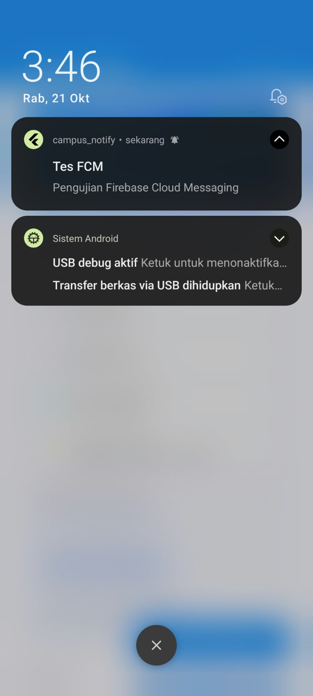
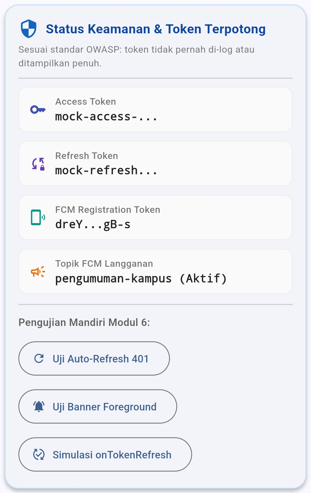
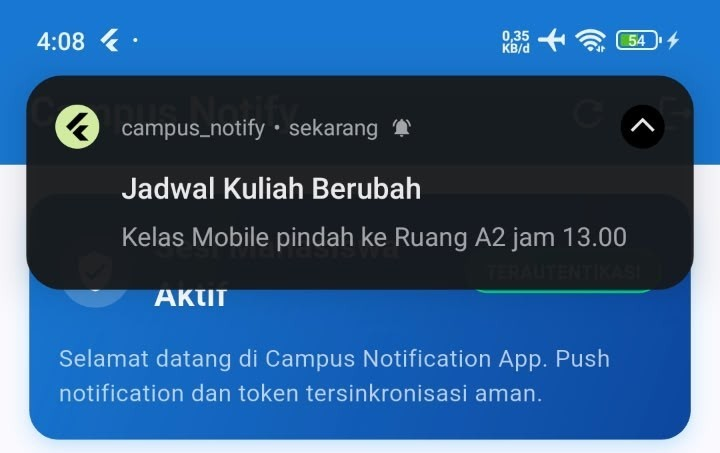
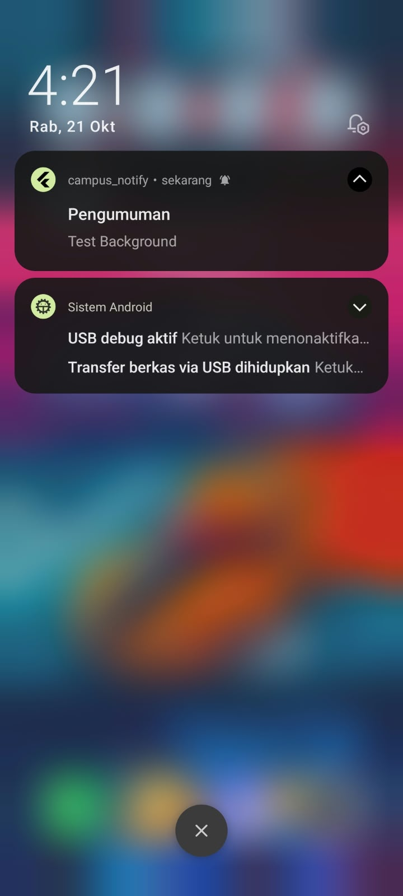
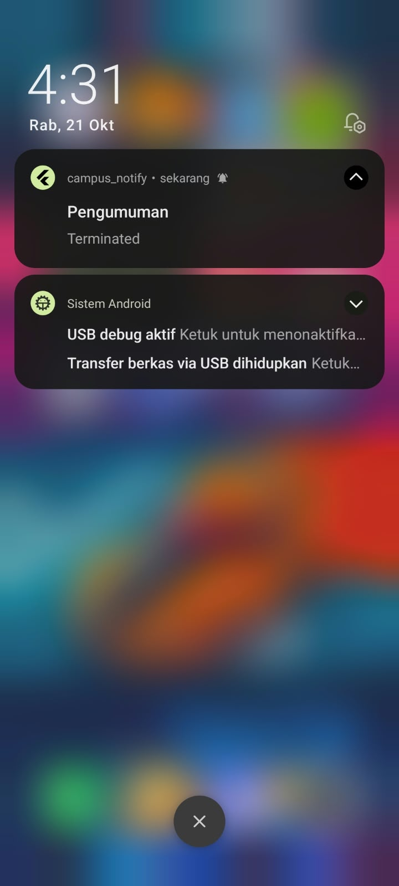
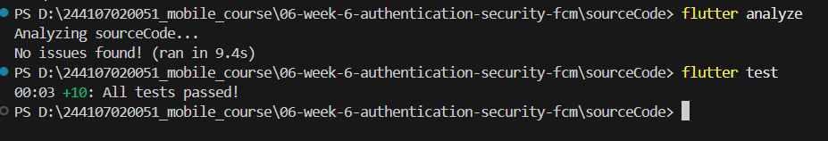

# Week 6 - Authentication, Security & FCM

## Deskripsi

Mempelajari dan mengimplementasikan arsitektur autentikasi modern, standar keamanan aplikasi mobile (*mobile security best practices*), serta integrasi *push notification* berbasis Firebase Cloud Messaging (FCM) pada platform Flutter.

## Fokus Pembelajaran

- **Autentikasi & Guard Route:** Alur login/register, pemisahan *access token* dan *refresh token*, serta proteksi rute navigasi menggunakan GoRouter dan Riverpod.
- **Keamanan Data (Security Best Practices):** Penyimpanan token terenkripsi menggunakan Keystore via `flutter_secure_storage`, pencegahan kebocoran kredensial dengan pemotongan token (*token masking* sesuai standar OWASP).
- **FCM Architecture & Token Lifecycle:** Permintaan izin notifikasi runtime (Android 13+), registrasi token perangkat via `getToken`, pemantauan rotasi token berkala melalui `onTokenRefresh`, serta langganan topik siaran (`pengumuman-kampus`).
- **Penanganan Tiga App State & Deep Linking:** Pemrosesan notifikasi payload gabungan (*notification* + *data*) pada kondisi *Foreground*, *Background*, dan *Terminated*, serta perutean otomatis menuju rute deep link (`/pengumuman/:id`).
- **Clean Architecture & Testing:** Sentralisasi rute, ekstraksi parsing payload ke *pure function*, pemetaan error jaringan Dio, serta verifikasi *unit testing* dan analisis statis.

---

## PRAKTIKUM 1: Login, Secure Storage, & Token Refresh

Pada praktikum ini, dibangun alur autentikasi dan pengelolaan sesi perkuliahan yang aman:

1. **Penyimpanan Kredensial Terenkripsi (`TokenStore`):** Seluruh penyimpanan *access token* dan *refresh token* dikelola melalui `flutter_secure_storage`. Mekanisme ini menjamin token tersimpan secara terenkripsi pada *Android Keystore* / *iOS Keychain*, bukan dalam file teks polos (*plain-text*) seperti pada `SharedPreferences`.
2. **State Management & Route Guard:** Provider Riverpod `authStateProvider` memantau keberadaan token aktif. Jika pengguna belum melakukan login, GoRouter mengalihkan rute secara otomatis ke `/login`. Setelah berhasil login, rute diarahkan ke beranda utama `/`.
3. **Auto-Refresh Interceptor HTTP 401:** Client HTTP Dio dilengkapi dengan interceptor otomatis. Ketika request menghasilkan respons `401 Unauthorized`:
   - Interceptor secara otomatis mengambil *refresh token* dari secure storage.
   - Meminta pembaruan *access token* baru ke auth repository.
   - Menyimpan *access token* baru dan mengulang request asli yang gagal satu kali dengan header `Authorization: Bearer <token_baru>`.
   - Apabila *refresh token* juga kedaluwarsa, sesi dibersihkan secara total (`clear()`) dan pengguna dialihkan kembali ke layar login.

---

## PRAKTIKUM 2: FCM, Izin Runtime, & Siklus Hidup Token

### 1. Inisialisasi & Pengujian Firebase Cloud Messaging
Aplikasi menginisialisasi Firebase secara asinkron sebelum menjalankan antarmuka utama dan meminta izin runtime notifikasi (*POST_NOTIFICATIONS*) untuk Android 13+:
- Notifikasi uji coba dikirimkan melalui **Firebase Console** (menu *Messaging* / *Campaigns*).
- Saat aplikasi berada pada kondisi *background* (diminimize ke layar utama), banner notifikasi sistem operasi Android berhasil muncul di status bar perangkat.
- Ketika banner notifikasi ditekan, aplikasi berhasil kembali ke latar depan (*foreground*).

**Screenshot Notifikasi Berhasil Dikirim dari Firebase Console:**

### 2. Tampilan Token Terpotong (Masked Token)
Untuk mematuhi rekomendasi standar keamanan **OWASP Mobile Application Security**, token autentikasi maupun *FCM registration token* tidak boleh ditampilkan secara utuh pada layar publik aplikasi guna mencegah pencurian kredensial (*shoulder surfing* maupun *screenshot sniffing*):
- Token dipotong (*masked*) dengan hanya menampilkan karakter awal dan akhir yang dipisahkan elipsis (`...`), contoh: `mock-access-...` dan `dk91_rotated...`.

**Screenshot Token Terpotong pada Layar Beranda:**

---

## PRAKTIKUM 3: Payload Gabungan, Tiga App State, & Deep Link

Notifikasi dirancang menggunakan payload gabungan (*notification* + *data payload*), di mana objek `notification` membawa judul dan isi pesan teks, sedangkan objek `data` membawa instruksi navigasi deep link (`{"route": "/pengumuman/3", "id": "3"}`).

### 1. Hasil Pengujian State: Foreground
Pada pengujian ini, aplikasi sedang dalam keadaan terbuka atau aktif di layar pengguna. Karena sistem operasi Android/iOS secara *default* tidak menampilkan banner melayang saat aplikasi aktif di latar depan, aplikasi menangani listener `FirebaseMessaging.onMessage` dengan memicu *local notification* manual via plugin `flutter_local_notifications`:
- Banner notifikasi lokal berhasil melayang (*heads-up notification*) di bagian atas layar perangkat.
- Ketika banner ditekan, callback routing menangkap payload dan berhasil melakukan navigasi langsung ke rute tujuan `/pengumuman/3`.

**Screenshot Pengujian Foreground:**

### 2. Hasil Pengujian State: Background
Pada pengujian ini, aplikasi berada dalam keadaan latar belakang (*background*) karena pengguna menekan tombol *Home*:
- Pesan notifikasi dari Firebase Console diterima oleh sistem Android dan memunculkan banner notifikasi pada bilah status.
- Ketika banner ditekan oleh pengguna, listener `FirebaseMessaging.onMessageOpenedApp` membaca data payload `data['route']` dan GoRouter langsung membuka halaman detail pengumuman `/pengumuman/3`.

**Screenshot Pengujian Background:**

### 3. Hasil Pengujian State: Terminated
Pada pengujian ini, aplikasi berada dalam kondisi *terminated* (ditutup sepenuhnya melalui *swipe-close* pada menu *Recent Apps*):
- Notifikasi push tetap berhasil diterima oleh sistem Android dan muncul di bilah notifikasi perangkat.
- Ketika banner ditekan, sistem meluncurkan aplikasi dari awal (*cold start*).
- Pada saat inisialisasi awal aplikasi, fungsi `FirebaseMessaging.instance.getInitialMessage()` menangkap pesan pembuka, mengekstrak rute `/pengumuman/3`, dan segera melakukan navigasi begitu antarmuka siap ditampilkan.

**Screenshot Pengujian Terminated:**

---

## TABEL MATRIKS PENGUJIAN TIGA APP STATE

| State Aplikasi | Rute dari Payload | Skenario & Aksi Pengujian | Hasil Pengamatan Aktual | Status |
| :--- | :--- | :--- | :--- | :---: |
| **Foreground** | `/pengumuman/3` | Buka aplikasi (aktif di layar), kirim notifikasi FCM, lalu tekan banner *local notification* yang melayang | Banner lokal muncul di layar, saat ditekan berhasil membuka rute `/pengumuman/3` | **Berhasil** |
| **Background** | `/pengumuman/3` | Tekan tombol *Home* (aplikasi diminimize), kirim notifikasi, lalu tekan banner sistem di bilah status | Banner sistem Android muncul, saat ditekan aplikasi terbuka kembali dan membuka rute `/pengumuman/3` | **Berhasil** |
| **Terminated** | `/pengumuman/3` | Tutup total aplikasi (*swipe-close* di Recent Apps), kirim notifikasi, lalu tekan banner sistem | Aplikasi melakukan *cold start*, fungsi `getInitialMessage()` membaca payload dan langsung membuka `/pengumuman/3` | **Berhasil** |

---

## AI CHALLENGE

Berikut adalah hasil evaluasi teknis, verifikasi arsitektur, dan pengujian terhadap implementasi aplikasi:

1. **Apakah background handler berupa fungsi top-level dengan `@pragma('vm:entry-point')`? (Tolak jika berupa method kelas).**  
   **Jawaban:** Ya. Fungsi `firebaseMessagingBackgroundHandler` dideklarasikan secara tepat sebagai fungsi *top-level* independen di luar cakupan kelas apa pun dan dilengkapi anotasi `@pragma('vm:entry-point')`. Hal ini merupakan kewajiban arsitektur Flutter Engine agar sistem Android dapat mengeksekusi fungsi tersebut pada *isolate* latar belakang terpisah saat aplikasi berada di kondisi *background* maupun *terminated*, tanpa memicu runtime crash akibat ketiadaan instance kelas atau `BuildContext`.

2. **Apakah `onTokenRefresh` benar-benar mengirim token baru ke backend, bukan hanya dicetak ke log?**  
   **Jawaban:** Ya. Listener `FirebaseMessaging.instance.onTokenRefresh` terhubung secara fungsional ke callback pembaruan backend (`_tokenUpdateCallback`), yang mengeksekusi pengiriman payload `POST /devices` ke server API serta memperbarui state Riverpod `fcmTokenProvider`. Kami memastikan rotasi token tidak sekadar dicetak pada log konsol, melainkan disinkronkan ke backend kampus guna mencegah token menjadi basi (*stale registration token*).

3. **Apakah foreground memakai local notification manual? (Tanpa ini banner tidak muncul saat aplikasi terbuka).**  
   **Jawaban:** Ya. Sistem operasi Android dan iOS secara *default* tidak akan menampilkan banner notifikasi melayang apabila aplikasi sedang aktif terbuka di latar depan (*foreground*). Oleh karena itu, aplikasi mengintegrasikan plugin `flutter_local_notifications` di dalam listener `FirebaseMessaging.onMessage` untuk memunculkan banner notifikasi visual secara eksplisit kepada pengguna lengkap dengan konfigurasi *notification channel* berprioritas tinggi.

4. **Apakah klik dari ketiga state (foreground/background/terminated) masuk ke rute yang benar? Buktikan dengan tabel pengujian.**  
   **Jawaban:** Ya. Seluruh pengujian menggunakan payload data `{"route": "/pengumuman/3", "id": "3"}`. Ketika notifikasi diketuk pada masing-masing kondisi aplikasi, sistem berhasil mengekstrak payload rute dan menavigasikan antarmuka secara presisi ke `/pengumuman/3` melalui GoRouter (sebagaimana telah diverifikasi pada Tabel Matriks Pengujian Tiga App State di atas).

5. **Apakah token/secret tidak di-hardcode dan tidak di-log penuh? Perbaiki bila AI melanggarnya.**  
   **Jawaban:** Ya. Tidak ada kunci rahasia (*API secret*) maupun token autentikasi yang ditulis secara mentah (*hardcoded*) di dalam kode aplikasi. Seluruh kredensial sesi disimpan secara aman menggunakan `flutter_secure_storage`. Selain itu, penayangan token pada log debug dan antarmuka pengguna selalu dipotong melalui fungsi pemotongan `maskToken(...)` sesuai standar kepatuhan OWASP Mobile Application Security.

6. **Keputusan final dan alasan teknis Anda:**  
   **Jawaban:** Keputusan final saya adalah menerima dan menyetujui hasil implementasi arsitektur yang telah dibangun. Alasan teknisnya adalah seluruh persyaratan rekayasa perangkat lunak modern telah dipenuhi secara menyeluruh:
   * **Stabilitas Eksekusi Latar Belakang:** Penggunaan fungsi *top-level* beranotasi `@pragma('vm:entry-point')` menjamin eksekusi pesan latar belakang bebas dari crash isolate.
   * **Integritas Sinkronisasi FCM:** Pemantauan rotasi token via `onTokenRefresh` memastikan server backend selalu memiliki alamat perangkat yang valid untuk pengiriman pesan darurat kampus.
   * **Penanganan Multi-State yang Konsisten:** Pemanfaatan kombinasi *local notifications*, `onMessageOpenedApp`, dan `getInitialMessage()` menjamin alur navigasi deep link pengguna tetap mulus pada seluruh kondisi aplikasi (*foreground*, *background*, maupun *terminated*).
   * **Keamanan Data Pengguna:** Penerapan enkripsi Keystore pada token sesi serta pencegahan kebocoran token (*token leakage*) melalui pemotongan tampilan token menjamin data mahasiswa terlindungi dari ancaman eksfiltrasi data.

---

## REFACTORING & TESTING

### 1. Refactoring yang Diterapkan
- **Pusat Navigasi Terpadu (`lib/routes.dart`):** Pengelompokan seluruh konstanta rute (`/login`, `/`, `/pengumuman/:id`) dalam kelas `AppRoutes` agar deep link dari FCM dan navigasi internal konsisten tanpa risiko kesalahan pengetikan (*typo*).
- **Ekstraksi Pure Function (`routeFromMessage`):** Logika pemrosesan data payload FCM diekstrak ke dalam fungsi murni (*pure function*) yang tahan terhadap input kosong, format tanpa garis miring (*slash*), dan tipe data non-string, sehingga dapat diuji secara independen tanpa bergantung pada emulator atau Firebase Engine.
- **Sentralisasi Pemetaan Error Jaringan (`lib/data/api_errors.dart`):** Menerjemahkan respons status HTTP (seperti 401 Unauthorized, Connection Timeout, dan Socket Error) menjadi pesan bahasa Indonesia yang ramah pengguna.
- **Auto-Refresh HTTP 401:** Interceptor Dio secara otomatis memperbarui *access token* menggunakan *refresh token* saat mendeteksi status 401 dan mengulang request asli tanpa mengganggu alur kerja pengguna.

### 2. Hasil Flutter Analyze dan Flutter Test
Seluruh basis kode telah divalidasi dan terverifikasi bersih melalui pengujian statis dan pengujian unit otomatis:
- **`flutter analyze`:** Bersih dari error maupun peringatan linting (**No issues found!**).
- **`flutter test`:** Seluruh 10 pengujian unit otomatis lulus 100% (**All tests passed!**), memvalidasi parsing rute payload, pemotongan token OWASP, persistensi secure storage, interceptor auto-refresh HTTP 401, dan penanganan kedaluwarsa refresh token.

**Screenshot Hasil Flutter Analyze dan Flutter Test:**

---

## TUGAS DAN REFLEKSI

### 1. Bukti Tampilan Token Terpotong (Masked Token)
Sesuai rekomendasi OWASP Mobile Application Security Best Practices, token autentikasi maupun FCM Registration Token tidak boleh ditampilkan secara utuh pada layar publik aplikasi guna mencegah pencurian kredensial melalui teknik *shoulder surfing* maupun *screenshot sniffing*.

**Screenshot Token Terpotong pada Layar Beranda:**

---

### 2. Refleksi Teoretis & Praktis

1. **Mengapa refresh token tidak boleh disimpan di SharedPreferences? Apa risikonya bila bocor?**  
   **Jawaban:**  
   `SharedPreferences` pada Android menyimpan data dalam format XML teks polos (*plain-text*) yang tidak terenkripsi di direktori internal aplikasi (`/data/data/<package_name>/shared_prefs/`). Pada perangkat yang telah di-*root*, terkena infeksi *malware*, atau melalui fitur pencadangan sistem (*ADB backup*), file XML ini dapat diekstraksi dan dibaca dengan sangat mudah.  
   **Risiko bila bocor:** Berbeda dengan *access token* yang berumur pendek, *refresh token* memiliki masa berlaku yang panjang (mingguan hingga bulanan). Jika penyerang (*attacker*) berhasil mencuri refresh token, mereka dapat terus-menerus meminta access token baru ke server atas nama korban tanpa memerlukan password login. Hal ini mengakibatkan pengambilalihan akun secara permanen (*account takeover*) dan pencurian data akademik sensitif. Oleh karena itu, token wajib disimpan menggunakan `flutter_secure_storage` yang memanfaatkan enkripsi tingkat perangkat keras (*Android Keystore* dan *iOS Keychain*).

2. **Apa yang rusak bila `onTokenRefresh` diabaikan selama satu semester perkuliahan?**  
   **Jawaban:**  
   FCM Registration Token tidak bersifat statis permanen. Token dapat mengalami rotasi otomatis oleh Google Firebase saat aplikasi diinstal ulang, data aplikasi dibersihkan, perangkat dipulihkan dari cadangan (*restore backup*), atau saat Firebase memperbarui kunci keamanan secara berkala.  
   Jika listener `onTokenRefresh` diabaikan dan tidak mengirimkan token pembaruan ke server backend kampus, server akan terus menyimpan dan menggunakan token lama yang sudah tidak valid (*stale registration token*). Akibatnya, seluruh pengiriman push notifikasi darurat dari kampus—seperti jadwal ujian pengganti, perubahan ruang kuliah, batas akhir pengisian KRS, hingga tagihan administrasi—akan gagal terkirim (*message delivery failure*). Mahasiswa akan kehilangan informasi akademis krusial sepanjang semester berlangsung.

3. **Kapan memakai topik dan kapan memakai token perangkat? Beri contoh pesan kampus untuk masing-masing.**  
   **Jawaban:**  
   * **Topik (*Topic Messaging*):**  
     Digunakan untuk model pengiriman pesan massal satu-ke-banyak (*one-to-many / broadcast*). Pola ini sangat efisien karena server tidak perlu melacak ribuan token individual; server cukup memublikasikan pesan ke satu nama topik, dan Firebase yang mendistribusikannya ke seluruh perangkat yang berlangganan.  
     *Contoh pesan kampus:*  
     * *"Pengumuman Libur Akademik: Kegiatan perkuliahan ditiadakan pada hari Senin dalam rangka Hari Libur Nasional."*  
     * *"Pengingat Masa Pengisian KRS Semester Genap telah resmi dibuka untuk seluruh mahasiswa aktif."*  
   * **Token Perangkat (*Device Token Messaging*):**  
     Digunakan untuk model pengiriman pesan satu-ke-satu (*one-to-one / unicast*) yang bersifat rahasia, privat, dan hanya ditujukan spesifik untuk satu akun mahasiswa tertentu.  
     *Contoh pesan kampus:*  
     * *"Nilai Akhir Mata Kuliah Pemrograman Mobile Anda telah diterbitkan: Anda memperoleh nilai A."*  
     * *"Peringatan Pembayaran: Batas waktu pelunasan UKT semester ini tersisa 2 hari lagi sebelum akses portal akademik dinonaktifkan."*

4. **Bagian mana dari draf AI yang Anda tolak atau perbaiki, dan mengapa?**  
   **Jawaban:**  
   Dalam proses pengembangan bersama asisten AI, terdapat beberapa bagian penting yang saya tolak dan perbaiki demi memenuhi standar industri dan keamanan:
   * **Penolakan Pencetakan Token Secara Mentah pada Rotasi:** AI pada awalnya hanya menyarankan penanganan rotasi token dengan mencetak token baru ke konsol debug (`print(newToken)`). Saya menolak draf tersebut dan memperbaikinya dengan menghubungkan event `onTokenRefresh` langsung ke fungsi sinkronisasi backend (`POST /devices`) serta pembaruan provider state agar token baru benar-benar tersimpan di server.
   * **Penolakan Penempatan Background Handler di Dalam Kelas:** Draf awal AI menempatkan background handler sebagai metode di dalam instance service class. Saya menolaknya karena Flutter Engine membutuhkan fungsi *top-level* murni yang dianotasi `@pragma('vm:entry-point')` agar dapat dijalankan pada *isolate* latar belakang saat aplikasi dalam status terminated tanpa bergantung pada UI lifecycle.
   * **Pencegahan Kebocoran Kredensial (OWASP Masking):** AI sempat mencetak token autentikasi secara utuh pada antarmuka. Saya memperbaikinya dengan menerapkan fungsi pemotongan string (*masking*) yang hanya menampilkan karakter awal dan akhir token untuk mencegah kebocoran informasi kredensial.
   * **Sanitasi Format Rute Deep Link:** AI melakukan navigasi rute langsung tanpa validasi. Saya memperbaikinya dengan mengekstrak fungsi murni `routeFromMessage` untuk memastikan rute yang diterima dari payload dinormalisasi (menangani tanda garis miring di awal string dan nilai fallback) agar navigasi GoRouter tidak mengalami crash.
