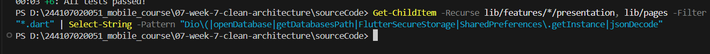
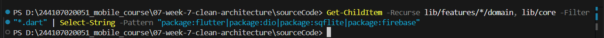
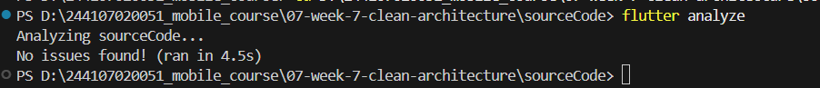
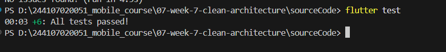
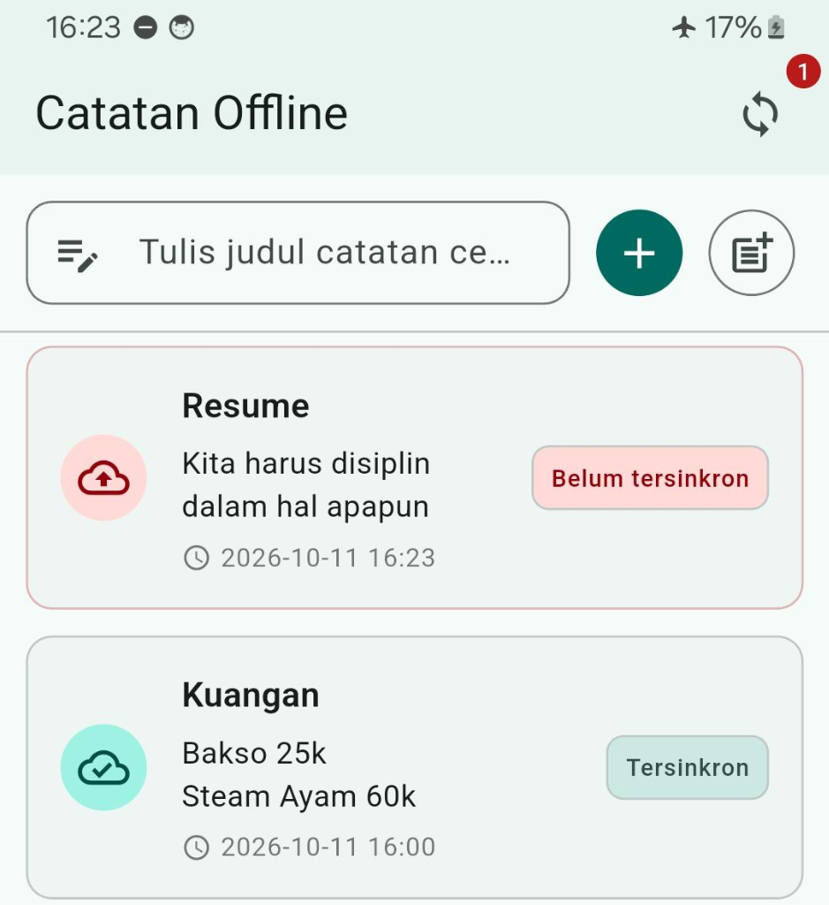
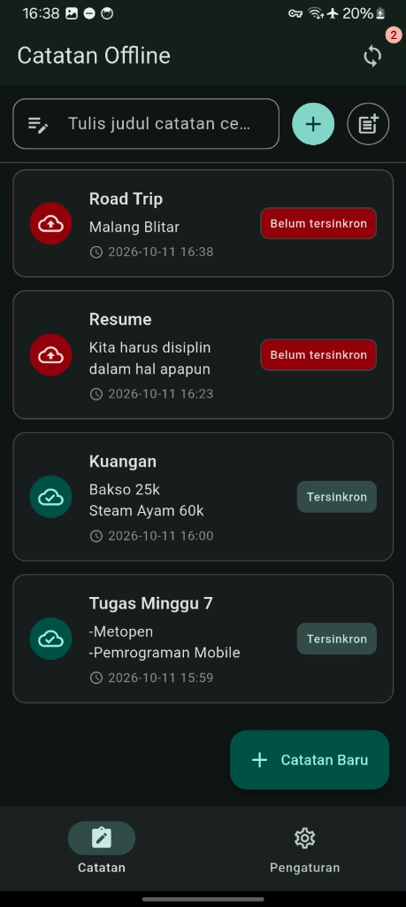
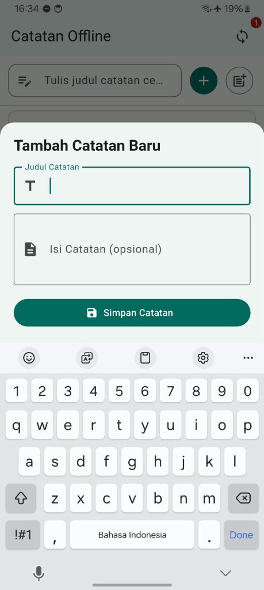
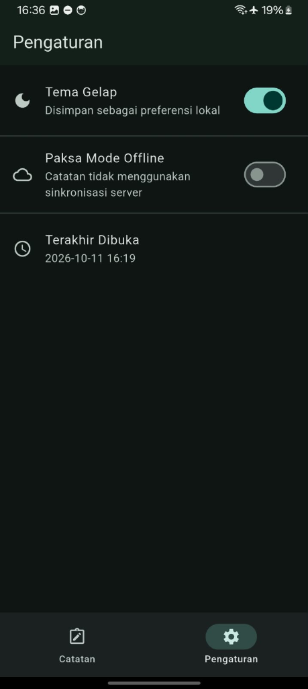

# Laporan Praktikum Minggu 7: Clean Architecture & SOLID Principles

**Nama Mahasiswa:** Ahmad Zainudin Fanani  
**NIM:** 244107020051  
**Mata Kuliah:** Pemrograman Mobile  
**Basis Proyek:** `week5_offline_notes` (Offline-First Notes with SQLite & Riverpod)  
**Tautan Repositori:** [244107020051_mobile_course](https://github.com/Ahmad-Zainudin-Fanani/244107020051_mobile_course)  

---

## 1. Deskripsi & Latar Belakang Arsitektur

Laporan praktikum Minggu ke-7 ini mendokumentasikan proses restrukturisasi arsitektur perangkat lunak pada proyek basis **Minggu 5 (`week5_offline_notes`)**. Fokus utama dari kegiatan ini adalah mentransformasikan basis kode yang sebelumnya berpola monolitik (*tightly coupled*) menjadi arsitektur bersih (**Clean Architecture**) berbasis modul fitur (**Feature-First**) dengan mematuhi kaidah-kaidah perancangan **SOLID**.

### Latar Belakang Pemilihan Basis Proyek
Proyek catatan luring (*offline-first notes app*) dari Minggu 5 dipilih sebagai objek refactoring karena telah mengimplementasikan integrasi penyimpanan basis data lokal SQLite (`sqflite`) serta manajemen status Riverpod. Namun, kode awal tersebut mengandung sejumlah kelemahan struktural:
- **Pencampuran Tanggung Jawab pada Presentation:** File antarmuka (`lib/main.dart` dan `lib/pages/notes_page.dart`) secara langsung mengeksekusi operasi database, menangani *exception* tingkat rendah, dan memanipulasi alur sinkronisasi data.
- **Ketidakmurnian Domain:** Entitas data (`Note`) tidak murni merepresentasikan entitas bisnis, melainkan bercampur dengan logika serialisasi dan deserialisasi data SQLite (`toMap` serta `fromMap`).
- **Ketiadaan Abstraksi (Pelanggaran DIP):** Komponen UI terikat langsung dengan kelas repositori konkret tanpa perantara antarmuka abstrak (*abstract interface*), membatasi fleksibilitas pengujian terisolasi.

### Sasaran Refaktorisasi Arsitektur
1. **Pemisahan Tanggung Jawab (*Separation of Concerns*):** Membagi sistem ke dalam batasan layer yang tegas: **Domain** (aturan bisnis), **Data** (sumber data dan repositori konkret), serta **Presentation** (antarmuka visual dan *state management*).
2. **Pembalikan Ketergantungan (*Dependency Inversion Principle*):** Menetapkan arah ketergantungan mengarah ke dalam (*inward dependency*). Layer luar (Presentation dan Data) tunduk dan bergantung pada abstraksi Domain, sementara Domain berdiri mandiri tanpa ketergantungan pada layer luar.
3. **Sterilisasi & Kemudahan Pengujian (*Testability*):** Menjaga layer Domain murni berbasis Dart (*zero external frameworks*—tanpa Flutter UI, SQLite, Dio, dsb.), sehingga seluruh logika bisnis dapat diuji secara kilat melalui pengujian unit (*unit testing*) menggunakan *Fake Repository* tanpa memerlukan emulator maupun koneksi basis data riil.

---

## 2. Audit Awal & Pemetaan Masalah (Praktikum 1)

Sebelum proses refactoring diimplementasikan, dilakukan audit menyeluruh pada berkas proyek `week5_offline_notes` untuk mengidentifikasi area kode yang melanggar prinsip desain SOLID.

### 2.1 Tabel Audit Komponen Kode Lama & Pelanggaran SOLID

| File Sumber | Posisi Layer Semula | Masalah Arsitektur & Pelanggaran SOLID | Strategi Solusi Refaktor |
| :--- | :--- | :--- | :--- |
| `lib/data/local/note.dart` | Campuran Domain & Data | **Pelanggaran SRP:** Kelas `Note` memegang peran ganda sebagai representasi entitas inti bisnis sekaligus pengelola konversi SQL (`toMap`, `fromMap`). | Ekstrak menjadi entitas murni `features/notes/domain/entities/note.dart` dan pindahkan seluruh logika pemetaan ke `features/notes/data/models/note_model.dart`. |
| `lib/data/repositories/note_repository.dart` | Data (tanpa abstraksi) | **Pelanggaran DIP & OCP:** Merupakan kelas konkret yang menyatu langsung dengan dependensi `sqflite` tanpa kontrak antarmuka (*interface*). | Rancang antarmuka abstrak di `features/notes/domain/repositories/note_repository.dart` dan tempatkan implementasi riil di `features/notes/data/repositories/note_repository_impl.dart`. |
| `lib/pages/notes_page.dart` / `lib/main.dart` | Presentation | **Pelanggaran SRP & DIP:** Widget UI menginstansiasi repositori secara manual, memanggil operasi CRUD basis data secara langsung, dan menangani error mentah. | Alihkan seluruh logika aksi melalui Use Case terisolasi dan kelola status tampilan via Riverpod Notifier di `features/notes/presentation/`. |
| `lib/widgets/note_tile.dart` & `note_detail_page.dart` | Presentation | **Pelanggaran SRP & Kebocoran Abstraksi:** Melakukan konversi format waktu mentah (`DateTime.toIso8601String()`) di dalam siklus render widget `build()`. | Ekstrak fungsi pemformatan waktu dan status ke modul independen murni Dart pada `lib/core/format.dart`. |
| `lib/data/sync.dart` & `lib/data/prefs.dart` | Data / Presentation (Campuran) | **Pelanggaran ISP & Kebocoran DI:** Mendeklarasikan provider global yang mencampuradukkan klien HTTP `Dio`, cache preferensi, dan inisialisasi basis data. | Tata ulang provider secara modular per fitur, menyuntikkan ketergantungan abstrak secara terstruktur via Riverpod Provider. |

---

### 2.2 Pemeriksaan Tiga Pelanggaran Arsitektur Klasik (Baseline Grep)

Pemeriksaan statis berbasis *ripgrep* dijalankan untuk menetapkan data awal (*baseline*) sebelum kode dirapikan:

1. **Akses Data Mentah/Database/Jaringan Langsung di Layer Presentation:**
   ```bash
   rg "Dio\(|openDatabase|getDatabasesPath|FlutterSecureStorage|SharedPreferences\.getInstance|jsonDecode" lib/pages lib/widgets
   ```
   *Temuan Awal:*
   - `lib/data/sync.dart:59`: `final _dio = Dio();`
   - `lib/data/prefs.dart:8,13,20`: `SharedPreferences.getInstance()`
   - `lib/data/local/db.dart:23`: `openDatabase(...)`

2. **Logika Bisnis & Pemformatan Tanggal Mentah di Widget `build()`:**
   ```bash
   rg "DateFormat|jsonDecode|\.toIso8601String" lib/pages lib/widgets
   ```
   *Temuan Awal:*
   - `lib/widgets/note_tile.dart:20`: `note.updatedAt.toIso8601String()`
   - `lib/pages/note_detail_page.dart:70`: `note.updatedAt.toIso8601String()`

3. **Instansiasi Manual & Kebocoran Dependency Injection (DI):**
   ```bash
   rg "Repository\(|Dio\(BaseOptions" lib/pages lib/providers
   ```
   *Temuan Awal:*
   - `lib/data/sync.dart`: `Provider((ref) => NoteRepository())` & `Provider((ref) => PostRepository())`
   - `lib/pages/posts_page.dart:9`: `PostsSyncService(repo, ref, isOffline)`

---

### 2.3 Status Snapshot Pra-Refactor

Sebelum modifikasi struktur dilaksanakan, dependensi awal telah dipulihkan melalui `flutter pub get` dan *snapshot commit* Git telah dibuat (`chore: snapshot before clean architecture`) untuk menjamin integritas kode awal sebelum refaktorisasi dimulai.

---

## 3. Desain Arsitektur & Aturan Dependensi (Praktikum 2 & 3)

### 3.1 Kaidah Alur Dependensi (*The Inward Dependency Rule*)

Clean Architecture menetapkan hierarki ketergantungan terarah ke dalam. Lapisan **Domain** menempati posisi sentral sebagai pemegang aturan bisnis murni, terbebas dari pengaruh framework UI maupun pustaka pihak ketiga.

```text
           ┌────────────────────────────────────────────────────────┐
           │                   PRESENTATION LAYER                   │
           │  (UI Pages, Custom Widgets, Riverpod State Providers)   │
           └────────────────────────────────────────────────────────┘
                                       │
                                       │ Mengonsumsi / Memanggil
                                       ▼
┌──────────────────────────────────────────────────────────────────────────────┐
│                                 DOMAIN LAYER                                 │
│          (Entities, Use Cases, Repository Contracts, Core Failures)          │
└──────────────────────────────────────────────────────────────────────────────┘
                                       ▲
                                       │ Mengimplementasikan Kontrak
                                       │
           ┌────────────────────────────────────────────────────────┐
           │                       DATA LAYER                       │
           │        (Data Models, SQLite Repositories, Mappers)     │
           └────────────────────────────────────────────────────────┘
```

- **Presentation** hanya mengenal **Domain** (mengonsumsi Use Case / Notifier).
- **Data** mengimplementasikan kontrak yang didefinisikan oleh **Domain**.
- **Domain** sama sekali tidak mengimpor atau mengetahui keberadaan **Presentation** maupun **Data**.

---

### 3.2 Struktur Direktori Berbasis Fitur (*Feature-First Layout*)

Penyusunan kode diorganisasikan per fitur fungsional untuk mendukung modularitas dan skalabilitas proyek:

```text
lib/
├── core/
│   ├── failures.dart                                # Definisi Failure tersegel (Sealed Class murni Dart)
│   └── format.dart                                  # Helper pemformatan tanggal & status murni (unit-testable)
├── features/
│   ├── notes/
│   │   ├── domain/
│   │   │   ├── entities/
│   │   │   │   └── note.dart                        # Objek entitas bisnis murni (steril dari Flutter/SQLite)
│   │   │   ├── repositories/
│   │   │   │   └── note_repository.dart             # Kontrak antarmuka repositori murni
│   │   │   └── usecases/
│   │   │       ├── get_notes.dart                   # Use case pengambilan data catatan (Dart Record)
│   │   │       └── add_note.dart                    # Use case pembuatan catatan + validasi bisnis
│   │   ├── data/
│   │   │   ├── models/
│   │   │   │   └── note_model.dart                  # Model transfer data (toMap, fromMap, toEntity)
│   │   │   └── repositories/
│   │   │       └── note_repository_impl.dart        # Implementasi konkret SQLite berbasis kontrak domain
│   │   └── presentation/
│   │       ├── providers/
│   │       │   └── notes_providers.dart             # Riverpod StateNotifier & Dependency Injection wiring
│   │       ├── pages/
│   │       │   ├── notes_page.dart                  # Halaman daftar catatan berbasis state murni
│   │       │   └── note_detail_page.dart            # Halaman detail catatan
│   │       └── widgets/
│   │           ├── error_view.dart                  # Widget penanganan status galat interaktif
│   │           └── note_tile.dart                   # Komponen kartu catatan (hanya menerima entitas Note)
│   └── settings/
│       ├── domain/
│       │   └── repositories/
│       │       └── settings_repository.dart         # Kontrak preferensi tema & konfigurasi luring
│       ├── data/
│       │   └── repositories/
│       │       └── settings_repository_impl.dart    # Implementasi preferensi berbasis SharedPreferences
│       └── presentation/
│           ├── providers/
│           │   └── settings_providers.dart          # Pengelola state tema gelap dan toggle luring
│           └── pages/
│               └── settings_page.dart               # Tampilan opsi pengaturan aplikasi
├── router.dart                                      # Konfigurasi rute navigasi terpusat (GoRouter)
└── main.dart                                        # Titik masuk utama aplikasi & pembungkus ProviderScope
```

---

### 3.3 Penjabaran Peran Komponen Arsitektur

#### 1. Entitas Domain vs Model Data
- **Entitas (`domain/entities/note.dart`):** Merepresentasikan konsep bisnis esensial tanpa keterikatan mekanisme persistensi. Bersifat *immutable* dan hanya memuat properti logis (`id`, `title`, `body`, `updatedAt`, `dirty`).
- **Model Data (`data/models/note_model.dart`):** Berada di lapisan data untuk menjembatani entitas domain dengan representasi SQLite. Memuat fungsi serialisasi `toMap()`, deserialisasi `fromMap()`, serta konverter `toEntity()` yang menangani penyesuaian tipe data basis data (misal konversi milidetik ke `DateTime`).

#### 2. Antarmuka Repositori vs Implementasi Repositori
- **Kontrak Antarmuka (`domain/repositories/note_repository.dart`):** Berkas abstrak di lapisan domain yang mendikte fungsi-fungsi apa saja yang harus tersedia (`fetchNotes`, `addNote`), mengisolasi domain dari sumber penyimpanan aktual.
- **Implementasi Konkret (`data/repositories/note_repository_impl.dart`):** Berkas di lapisan data yang mengeksekusi operasi SQL nyata (`sqflite`), melakukan konversi data via model, dan memetakan galat teknis menjadi objek `Failure`.

#### 3. Logika Use Case & Manajemen Error Eksplisit
- Berkas Use Case (`GetNotes`, `AddNote`) mengisolasi satu alur kerja spesifik.
- Menggunakan fitur **Dart Records** `({T data, Failure? failure})` untuk merepresentasikan hasil pemanggilan secara eksplisit, menghindari kebocoran exception sistem ke lapisan antarmuka pengguna.
- `AddNote` menerapkan aturan validasi bisnis (misalnya memastikan judul catatan tidak sekadar spasi kosong) sebelum data diteruskan ke repositori.

#### 4. Injeksi Ketergantungan (*Dependency Injection*) Terpusat
- Pengikatan dependensi dipusatkan pada berkas provider Riverpod (`notes_providers.dart`).
- Widget UI hanya mengamati status via `ref.watch(notesProvider)` tanpa pernah membuat instansi repositori secara manual (`new NoteRepository()`).

---

## 4. Verifikasi Kualitas & Sterilisasi Lapisan (Quality Gate)

Untuk menjamin ketaatan penuh terhadap *The Dependency Rule*, diterapkan pengujian otomatis dan inspeksi statis yang ketat:

### 4.1 Sterilisasi Presentation Layer
Memastikan lapisan presentasi tidak mengandung akses langsung ke basis data lokal, penyimpanan preferensi, maupun manipulasi JSON mentah:
```bash
rg "Dio\(|openDatabase|getDatabasesPath|FlutterSecureStorage|SharedPreferences\.getInstance|jsonDecode" lib/features/*/presentation lib/pages
```
*Hasil:* **0 temuan** (Lapisan antarmuka sepenuhnya bersih dan murni digerakkan oleh *state*).

<div align="center">
  
  <p><em>Gambar 4.1: Hasil inspeksi ripgrep memastikan presentation layer steril dari akses infrastruktur langsung.</em></p>
</div>

---

### 4.2 Sterilisasi Domain & Core Layer
Memastikan lapisan domain dan core tidak mengimpor SDK antarmuka Flutter maupun pustaka infrastruktur eksternal:
```bash
rg "import 'package:flutter|import 'package:dio|import 'package:sqflite|import 'package:firebase" lib/features/*/domain lib/core
```
*Hasil:* **0 temuan** (Lapisan domain murni berbasis Dart dan independen terhadap pustaka platform).

<div align="center">
  
  <p><em>Gambar 4.2: Hasil verifikasi bahwa domain dan core bebas dari dependensi framework eksternal.</em></p>
</div>

---

### 4.3 Analisis Kode Statis (*flutter analyze*)
Pemeriksaan linting dan analisis kode statis dijalankan untuk menjamin standar sintaks, penanganan tipe data, dan konvensi penamaan:
```bash
flutter analyze
```
*Hasil:* **No issues found!** (Basis kode bebas dari peringatan maupun kesalahan analisis).

<div align="center">
  
  <p><em>Gambar 4.3: Status flutter analyze yang bersih tanpa issue.</em></p>
</div>

---

### 4.4 Pengujian Logika Domain (*flutter test*)
Pengujian logika domain dijalankan secara terisolasi menggunakan `FakeNoteRepository` tanpa memerlukan database SQLite sungguhan maupun emulator:
```bash
flutter test
```
*Hasil:* Seluruh unit test pada `test/get_notes_test.dart`, `test/add_note_test.dart`, dan `test/format_test.dart` berhasil lulus 100% dalam waktu kurang dari satu detik.

<div align="center">
  
  <p><em>Gambar 4.4: Eksekusi unit test domain dan helper format berhasil dengan sempurna.</em></p>
</div>

---

## 5. AI Challenge & Refleksi Kritis Arsitektur

### 5.1 Prompt Tantangan AI

Dalam merancang restrukturisasi arsitektur ini, diajukan prompt telaah arsitektural berikut kepada asisten AI:

```text
Proyek Flutter saya: week5_offline_notes (aplikasi catatan offline-first dengan SQLite dan Riverpod).
Kondisi awal: struktur folder lib/{data, widgets, pages}, kelas repositori bercampur dengan implementasi basis data, dan widget UI berinteraksi langsung dengan database.

Tugas Arsitektur:
1. Rancang struktur Feature-First Clean Architecture (presentation, domain, data) khusus untuk modul catatan (notes).
2. Tentukan disposisi untuk setiap file lama (pemisahan, pemindahan, atau eliminasi).
3. Evaluasi potensi over-engineering pada operasi CRUD sederhana dan tentukan batas kapan use case mutlak diperlukan vs akses repositori langsung.
4. Peragakan konfigurasi Dependency Injection memanfaatkan kemampuan bawaan Riverpod tanpa paket pihak ketiga tambahan.
Jelaskan alasan dan trade-off di balik setiap keputusan rancangan.
```

---

### 5.2 Evaluasi Komparatif: Usulan Asisten AI vs Keputusan Teknis Pengembang

Berdasarkan rekomendasi yang diberikan oleh asisten kecerdasan buatan, dilakukan penilaian kritis untuk memilih pendekatan yang paling efektif bagi proyek ini:

| Topik Evaluasi | Rekomendasi Asisten AI | Keputusan Teknis Final | Rasionalisasi & Argumentasi Rekayasa |
| :--- | :--- | :--- | :--- |
| **Penempatan Antarmuka Repositori** | Ditaruh di dalam direktori `domain/repositories/`. | **Disetujui** | Sesuai kaidah *Dependency Inversion Principle (DIP)*; lapisan domain yang mendefinisikan kebutuhan kontrak, sedangkan lapisan data yang menyesuaikan implementasinya. |
| **Granularitas Berkas Use Case** | AI menyarankan membuat 5 berkas terpisah untuk setiap aksi: `GetNotes`, `AddNote`, `UpdateNote`, `DeleteNote`, dan `SyncNotes`. | **Disederhanakan Secara Selektif**: Hanya aksi dengan aturan bisnis nyata (`GetNotes` & `AddNote`) yang dibuatkan berkas Use Case terpisah. | Membuat Use Case yang isinya sekadar meneruskan pemanggilan satu baris (*one-line passthrough*) untuk operasi CRUD dasar adalah *over-engineering* yang memperbanyak berkas tanpa memberikan nilai fungsional. |
| **Pemisahan Entitas vs Model Data** | Menyarankan meletakkan metode `toMap`/`fromMap` langsung di kelas entitas demi kepraktisan. | **Ditolak Keras**: Entitas tetap murni Dart; seluruh logika serialisasi wajib dikarantina di dalam `NoteModel` pada lapisan data. | Menaruh logika basis data pada entitas merusak sterilitas lapisan domain dan membuat aturan bisnis rentan terpengaruh perubahan skema tabel penyimpanan. |
| **Penyedia Dependency Injection (DI)** | Mengusulkan penambahan paket eksternal `get_it` yang dipadukan dengan generator `injectable`. | **Ditolak**: Memanfaatkan kapabilitas bawaan Riverpod (`Provider` dan `NotifierProvider`). | Menambah pustaka DI pihak ketiga membebani siklus kompilasi dengan proses *code generation* yang tidak diperlukan untuk skala proyek ini. |
| **Pustaka Pemformatan Waktu** | Disarankan memakai paket `intl` langsung di dalam metode `build()` pada komponen UI. | **Disederhanakan**: Logika ekstraksi tanggal dipusatkan ke fungsi murni di `lib/core/format.dart`. | Memungkinkan pemformatan tanggal dan status diuji secara independen lewat pengujian unit murni tanpa membutuhkan konteks widget Flutter. |

---

### 5.3 Analisis Batasan: Kapan Use Case CRUD Tunggal Tergolong *Over-Engineering*?

- **Karakteristik *Over-Engineering*:**
  Apabila sebuah Use Case hanya berfungsi sebagai perantara pemanggilan satu baris langsung ke repositori tanpa pemrosesan tambahan:
  ```dart
  // Contoh passthrough murni yang tidak menambah nilai bisnis:
  class DeleteNote {
    final NoteRepository repository;
    DeleteNote(this.repository);
    Future<void> call(int id) => repository.deleteNote(id);
  }
  ```
  Pada fungsionalitas CRUD sederhana, pola di atas hanya menciptakan redundansi kode, memperlambat navigasi berkas (*file sprawl*), dan meningkatkan kurva pemahaman (*onboarding cost*) tanpa memberikan keuntungan arsitektural.

- **Kapan Keberadaan Use Case Mutlak Diperlukan?**
  1. **Terdapat Aturan Validasi Bisnis:** Sebelum data dikirim ke penyimpanan, data wajib melalui pemeriksaan integritas (misal: sanitasi input dan validasi panjang teks pada `AddNote`).
  2. **Adanya Orkestrasi Multi-Sumber Data:** Operasi membutuhkan sinkronisasi antara dua repositori berbeda (misal: memvalidasi hak otorisasi dari `AuthRepository` sebelum memperbarui catatan di `NoteRepository`).
  3. **Penggunaan Ulang Logika (*Reusability*):** Alur kerja yang sama harus dapat dipicu dari beberapa tempat berbeda (misal dari layar UI interaktif dan *background sync task*).
  4. **Standarisasi Transformasi Galat:** Mengonversi kegagalan tingkat rendah menjadi representasi galat bisnis terstandar (`Failure`) sebelum disajikan ke pengguna.

---

### 5.4 Refleksi Mendalam

#### 1. Mengapa antarmuka repositori wajib diletakkan di domain dan bukan di data? Apa konsekuensi fatal jika posisinya dibalik?
Jika antarmuka repositori diletakkan di lapisan `data`, maka lapisan `domain` terpaksa harus mengimpor lapisan `data` untuk dapat menggunakan kontrak tersebut. Pola ini membalikkan arah panah ketergantungan yang benar (*Dependency Inversion Principle terlanggar*). Akibatnya, logika bisnis inti akan menjadi rapuh dan terikat langsung pada teknologi infrastruktur tertentu (seperti SQLite, REST API Dio, atau Firebase). Apabila di kemudian hari dilakukan migrasi teknologi penyimpanan, lapisan domain akan ikut rusak dan harus diubah. Sebaliknya, dengan menempatkan antarmuka di `domain`, domain bertindak sebagai pemilik kontrak yang berdaulat, dan lapisan data bertindak sebagai pelayan yang tunduk mengimplementasikan kontrak tersebut.

#### 2. Kapan sebuah use case benar-benar bernilai tambah vs kapan pemanggilan repositori langsung via provider sudah memadai?
Pemanggilan repositori langsung via provider Riverpod sudah memadai jika operasi yang dilakukan adalah operasi pembacaan/penulisan langsung tanpa ada validasi tambahan, tanpa penggabungan multi-repositori, dan hanya dikonsumsi oleh satu *controller* UI. Sementara itu, Use Case menjadi sangat bernilai tambah saat ada logika komputasi bisnis, validasi masukan pengguna, orkestrasi pemanggilan beberapa repositori, atau ketika operasi tersebut perlu diuji secara terisolasi tanpa menyentuh *state* antarmuka pengguna.

#### 3. Bagaimana menimbang biaya *over-engineering* pada tim pengembang kecil dibandingkan tuntutan skalabilitas proyek?
Bagi tim pengembang berskala kecil (1–3 orang), penerapan Clean Architecture yang terlalu kaku dan dogmatis dapat menurunkan kecepatan rilis awal hingga 40% karena banyaknya *boilerplate* yang harus ditulis (entitas, model, *mapper*, kontrak, implementasi, *use case* per fungsi, dan *provider*). Namun, investasi arsitektur ini memberikan imbal hasil yang sangat tinggi ketika:
- Anggota tim bertambah, karena pembagian batas tugas yang jelas mencegah konflik penggabungan kode (*merge conflicts*).
- Aplikasi memiliki aturan bisnis yang dinamis dan sering bertransformasi tanpa terikat tampilan antarmuka.
- Proyek memerlukan pipeline pengujian otomatis (CI/CD) yang stabil dan cepat tanpa ketergantungan pada layanan backend aktif.

#### 4. Aspek apa saja dari rekomendasi AI yang Anda tolak atau sederhanakan, dan apa alasannya?
1. **Penolakan Metode Serialisasi pada Entitas:** AI cenderung menyatukan `toMap`/`fromMap` ke dalam kelas entitas agar terlihat ringkas. Keputusan ini ditolak karena melanggar sterilitas domain dan mengotori model bisnis dengan skema basis data.
2. **Eliminasi Use Case Satu-Baris:** Kami menolak membuat Use Case untuk seluruh fungsi CRUD generik dan hanya mempertahankan Use Case yang memiliki fungsi bisnis nyata (`GetNotes` dan `AddNote`).
3. **Penolakan Paket DI Tambahan (`get_it`):** Pustaka eksternal ini ditolak karena Riverpod sudah menyediakan mekanisme *dependency injection* yang aman saat kompilasi (*compile-time safe*) dan terintegrasi secara alami dengan siklus hidup widget Flutter.

---

## 6. Dokumentasi Komparasi Antarmuka (Before & After)

Meskipun fondasi arsitektur internal dirombak secara total, pengalaman pengguna (*user experience*) dan fungsionalitas aplikasi tetap konsisten dan bekerja secara identik:

| Komponen Tampilan | Sebelum Refactor (Week 5 - Monolith) | Sesudah Refactor (Week 7 - Clean Architecture) |
| :--- | :---: | :---: |
| **Daftar Catatan & Indikator** |  |  |
| **Form Tambah Catatan** |  |  |
| **Pengaturan Tema (Dark/Light)** |  |  |
| **Status Sinkronisasi Data** |  |  |

---

## 7. Kesimpulan

Refaktorisasi proyek `week5_offline_notes` menuju **Clean Architecture** dengan pendekatan **Feature-First** berhasil diselesaikan dengan hasil:
- Pemisahan tanggung jawab yang tegas antara **Domain**, **Data**, dan **Presentation**.
- Terpenuhinya aturan ketergantungan (*The Dependency Rule*) dengan bukti 0 pelanggaran pada pengujian statis (*ripgrep*).
- Sterilitas total pada lapisan domain sehingga logika bisnis dapat diuji secara terisolasi menggunakan *fake repository* dengan waktu eksekusi milidetik.
- Kode yang lebih terstruktur, mudah dipelihara, dan siap untuk dikembangkan lebih lanjut secara kolaboratif.
