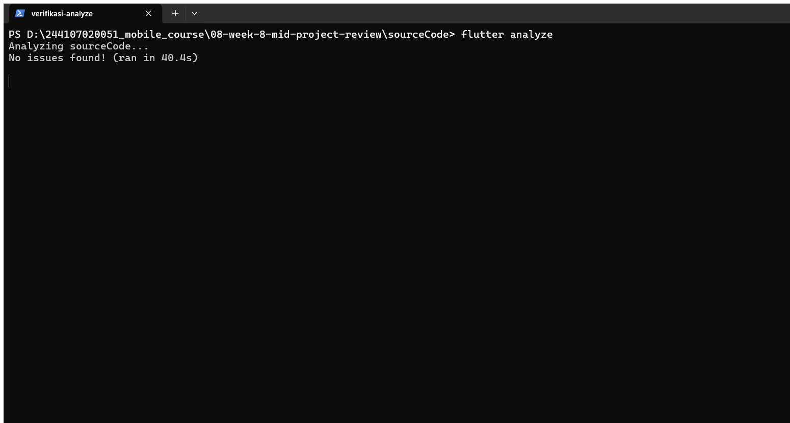
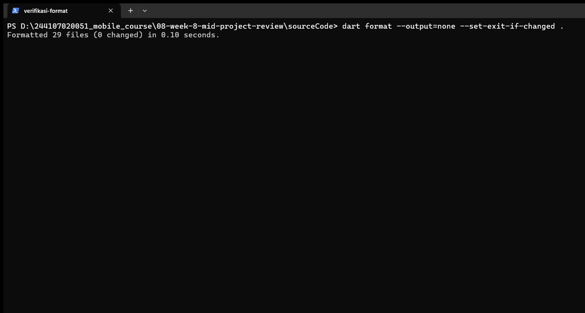
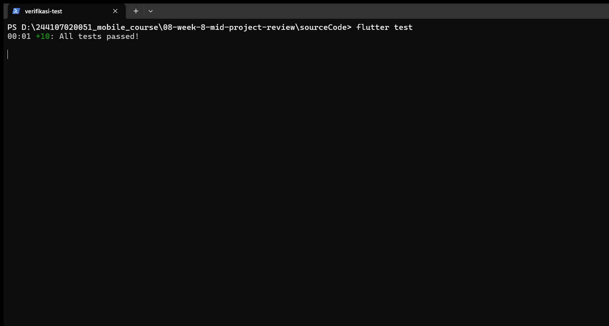
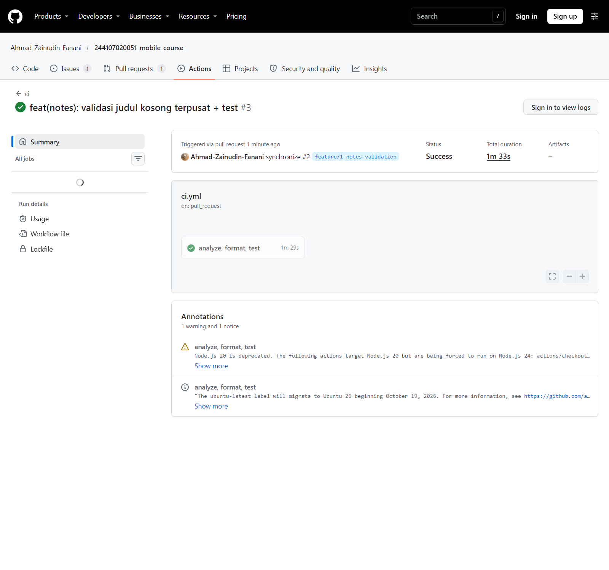
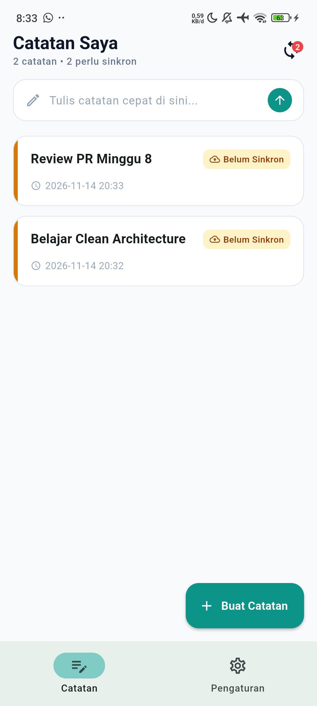
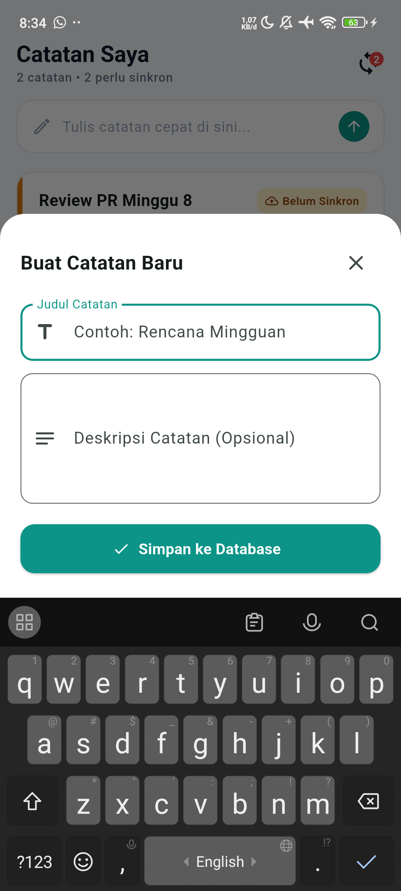
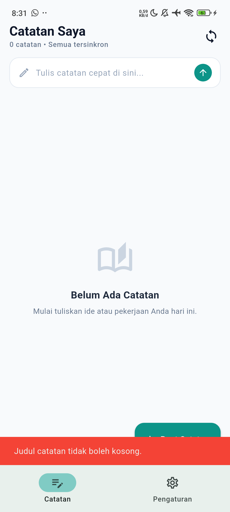

# Laporan Praktikum Minggu 8: Mid Project Review & Code Review

**Nama Mahasiswa:** Ahmad Zainudin Fanani  
**NIM:** 244107020051  
**Mata Kuliah:** Pemrograman Mobile  
**Basis Proyek:** `week5_offline_notes` — hasil refaktor Clean Architecture Minggu 7  
**Tautan Repositori:** [244107020051_mobile_course](https://github.com/Ahmad-Zainudin-Fanani/244107020051_mobile_course)  
**Issue:** [#1 Validasi judul catatan terpusat + feedback input kosong](https://github.com/Ahmad-Zainudin-Fanani/244107020051_mobile_course/issues/1)  
**Pull Request:** [#2 feat(notes): validasi judul kosong terpusat + test](https://github.com/Ahmad-Zainudin-Fanani/244107020051_mobile_course/pull/2)

---

## 1. Ringkasan Status Paruh Semester

Minggu 8 bukan pembuatan aplikasi baru. Fokus praktikum ini adalah **meninjau kualitas rekayasa** project Minggu 5–7, memperbaiki satu temuan nyata melalui Pull Request kecil, dan membuktikan bahwa fondasi paruh semester dapat dipercaya untuk separuh perkuliahan berikutnya.

Aplikasi berjalan identik dengan akhir Minggu 7, dengan satu perbaikan perilaku yang berasal dari review: **validasi judul catatan kini terpusat di satu fungsi murni dan quick-add tidak lagi gagal secara senyap**.

| Aspek Kesiapan | Target | Hasil |
| :--- | :--- | :---: |
| Aplikasi berjalan identik akhir Minggu 7 | Ya | **Lolos** |
| `flutter analyze` | 0 issue | **Lolos** — No issues found! |
| `dart format --set-exit-if-changed .` | 0 file berubah | **Lolos** |
| `flutter test` | Semua hijau | **Lolos** — 10 test |
| PR kecil melalui review | ≥ 1 PR | **Lolos** — PR #2 |
| README, screenshot, cara menjalankan | Lengkap | **Lolos** |
| Dokumentasi AI + keputusan final | Lengkap | **Lolos** — `docs/ai-review-vs-keputusan.md` |

---

## 2. Ruang Lingkup Perubahan Minggu 8

Supaya PR tetap kecil dan dapat direview cepat, perubahan dibatasi pada satu masalah:

**Masalah.** Aturan “judul tidak boleh kosong” ditulis dua kali — di `AddNote` (domain) dan langsung di `notes_page.dart` (presentation). Selain itu, tombol kirim pada *quick-add capsule* melakukan `return` tanpa pesan saat input kosong.

**Solusi.** Aturan validasi diekstrak ke `lib/core/validation.dart`, dipakai bersama oleh domain dan UI, lalu quick-add menampilkan SnackBar ketika input kosong. Perilaku aplikasi lain tidak diubah.

**Bukti perubahan terisolasi.** Commit `chore(week8)` menyalin project Minggu 7 sebagai baseline. Commit `feat(notes)` hanya menyentuh 4 berkas fitur dengan tambahan ±60 baris efektif:

| Berkas | Perubahan |
| :--- | :--- |
| `lib/core/validation.dart` | **Baru** — fungsi murni `validateNoteTitle` + konstanta pesan |
| `lib/features/notes/domain/usecases/add_note.dart` | Memakai validator bersama |
| `lib/features/notes/presentation/pages/notes_page.dart` | Quick-add menampilkan error; modal memakai validator yang sama |
| `test/validate_note_test.dart` | **Baru** — 4 unit test kasus kosong, whitespace, valid, dan trim |

---

## 3. Alur Kerja Git

### 3.1 Branching Model

| Branch | Peran | Status di Repositori |
| :--- | :--- | :--- |
| `main` | Selalu dapat dirilis, dilindungi | Ada; tidak menerima commit langsung |
| `develop` | Integrasi fitur mingguan, target default PR | Dibuat dari `main`, di-push, dijadikan default branch |
| `feature/1-notes-validation` | Kerja satu fitur, pendek | Dibuat dari `develop`, di-merge via PR #2 |
| `feat/*` / `fix/*` | Pola branch kerja berikutnya | Mengikuti konvensi yang sama |

Alur yang dijalankan:

```text
Issue #1
  -> branch feature/1-notes-validation (dari develop)
  -> commit kecil: chore baseline -> feat validasi -> ci -> docs
  -> PR #2 "Closes #1" -> review checklist -> squash merge ke develop
  -> branch fitur dihapus, issue tertutup otomatis
```

### 3.2 Commit Berkualitas

Commit Minggu 8 memakai format `tipe(scope): deskripsi singkat`:

| Commit | Tipe | Alasan |
| :--- | :--- | :--- |
| `chore(week8): salin project Minggu 7 sebagai baseline mid review` | chore | Perubahan mekanis (salinan project), bukan fitur |
| `feat(notes): validasi judul kosong terpusat + test` | feat | Satu perubahan logis yang dapat direview dan di-revert |
| `chore(ci): tambah workflow analyze, format, dan test` | chore | Perubahan pipeline terpisah dari kode fitur |
| `fix(ci): pin Flutter 3.47.2 agar analyze konsisten dengan SDK lokal` | fix | CI memakai SDK yang sama dengan pengembangan agar `deprecated_member_use` yang tidak muncul lokal tidak menggagalkan pipeline |
| `docs(week8): tambah laporan mid review, checklist, dan dokumentasi AI` | docs | Dokumentasi dan bukti, tanpa mengubah perilaku |

Audit riwayat lama dan tabel perbaikan tiga pesan commit tersedia di [`docs/review-checklist.md`](docs/review-checklist.md#2-perbaikan-pesan-commit-lama).

---

## 4. Issue dan Pull Request

| Item | Tautan |
| :--- | :--- |
| Issue | [#1 — Validasi judul catatan terpusat + feedback input kosong](https://github.com/Ahmad-Zainudin-Fanani/244107020051_mobile_course/issues/1) |
| Branch | `feature/1-notes-validation` → `develop` |
| Pull Request | [#2 — feat(notes): validasi judul kosong terpusat + test](https://github.com/Ahmad-Zainudin-Fanani/244107020051_mobile_course/pull/2) |
| Strategi merge | Squash merge, branch fitur dihapus setelah merge |

Template PR yang dipakai:

```text
Judul: feat(notes): validasi judul kosong terpusat + test

Masalah: aturan validasi judul ditulis dua kali (domain + UI) dan
  quick-add gagal senyap saat input kosong.
Solusi: ekstrak validateNoteTitle ke core/validation.dart, pakai di
  AddNote dan notes_page, tampilkan SnackBar pada quick-add kosong.
Cara uji:
  1) buka aplikasi, tekan kirim pada quick-add kosong -> SnackBar muncul.
  2) flutter test test/validate_note_test.dart
  3) flutter analyze && dart format --set-exit-if-changed .
Closes #1
```

---

## 5. Review Sejawat

Repositori ini bersifat individu, sehingga peran reviewer dijalankan sebagai **self-review terstruktur** dengan checklist yang sama seperti review pasangan. Setiap temuan wajib menyebut observasi, dampak, dan usulan konkret — bukan komentar gaya “kode ini jelek”.

| ID | Kategori | Temuan | Keputusan |
| :---: | :--- | :--- | :---: |
| R1 | Kebenaran | Quick-add `return` tanpa pesan saat judul kosong | **Diperbaiki** |
| R2 | Kebenaran | Validasi judul terduplikasi di domain dan UI, pesan berpotensi berbeda | **Diperbaiki** |
| R3 | Arsitektur | Validasi harus tetap dimiliki domain; UI tidak boleh menjadi satu-satunya penjaga aturan | **Dipertahankan** |
| R4 | Test | Belum ada kasus judul berisi spasi, tab, dan baris baru | **Diperbaiki** |
| R5 | Keterbacaan | Pesan error hardcoded di dua tempat | **Diperbaiki** |

Detail observasi → dampak → usulan, checklist kesiapan, serta status tindak lanjut ada di [`docs/review-checklist.md`](docs/review-checklist.md).

---

## 6. Quality Gate Mesin

Semua pemeriksaan dijalankan di `08-week-8-mid-project-review/sourceCode`:

```bash
flutter analyze
dart format --set-exit-if-changed .
flutter test
```

| Pemeriksaan | Hasil |
| :--- | :--- |
| `flutter analyze` | `No issues found!` |
| `dart format --output=none --set-exit-if-changed .` | `Formatted 29 files (0 changed)` |
| `flutter test` | `All tests passed!` — 10 test |

<div align="center">
  
  <p><em>Gambar 6.1: Static analysis bersih tanpa issue.</em></p>
</div>

<div align="center">
  
  <p><em>Gambar 6.2: Seluruh berkas sesuai format resmi Dart.</em></p>
</div>

<div align="center">
  
  <p><em>Gambar 6.3: Sepuluh unit test lulus, termasuk empat test validasi baru.</em></p>
</div>

---

## 7. CI: Penolakan Otomatis

Workflow [`.github/workflows/ci.yml`](../.github/workflows/ci.yml) menjalankan empat langkah pada setiap Pull Request ke `develop`/`main`: `flutter pub get`, `flutter analyze`, `dart format --set-exit-if-changed .`, dan `flutter test` di direktori `08-week-8-mid-project-review/sourceCode`.

Versi Flutter di-pin ke **3.47.2** (sama dengan SDK pengembangan) agar hasil `flutter analyze` konsisten. Tanpa pin, runner `stable` terbaru menandai `package:flutter/material.dart` sebagai deprecated dan menggagalkan pipeline meskipun kode berjalan normal di SDK proyek.

Dengan demikian PR yang kotor ditolak mesin sebelum dibaca manusia, dan debat gaya/spasi tidak lagi memakan waktu review.

<div align="center">
  
  <p><em>Gambar 7.1: Workflow CI berhasil pada branch fitur.</em></p>
</div>

---

## 8. Verifikasi Saran AI

AI dipakai sebagai reviewer awal, bukan pengambil keputusan. Prompt, ringkasan output awal, checklist verifikasi, dan tabel usulan-vs-keputusan final didokumentasikan di [`docs/ai-review-vs-keputusan.md`](docs/ai-review-vs-keputusan.md).

Ringkasan keputusan:

| Temuan AI | Level | Keputusan | Alasan singkat |
| :--- | :---: | :---: | :--- |
| Validasi judul terduplikasi | Blocker | **Diterima** | Terbukti 2 lokasi literal pesan; diekstrak ke `core/validation.dart` |
| Quick-add gagal senyap | Blocker | **Diterima** | Reproduksi manual: input kosong tidak memberi umpan balik |
| Pindahkan seluruh validasi ke `TextFormField.validator` | Saran | **Ditolak** | Melanggar dependency rule; quick-add bukan form dan domain harus tetap menjaga aturan |
| Tambah paket `form_builder`/`intl` | Saran | **Ditolak** | Fungsi murni 8 baris sudah cukup; menambah dependensi memperlambat build |
| Tambah test whitespace/tab | Test | **Diterima** | Empat test baru di `test/validate_note_test.dart` |
| Pecah `build()` halaman catatan menjadi widget kecil | Saran | **Ditunda** | Di luar ruang lingkup PR ini; dicatat sebagai issue refactor berikutnya |

Setiap temuan yang diterima memiliki bukti (`grep`/hasil test), dan setiap penolakan memiliki alasan teknis tertulis.

---

## 9. Struktur Folder

```text
08-week-8-mid-project-review/
├── README.md                          # laporan ini
├── docs/
│   ├── review-checklist.md            # audit Git, review checklist, kesiapan mid semester
│   └── ai-review-vs-keputusan.md      # prompt AI, temuan, verifikasi, keputusan final
├── Screenshots/
│   ├── app_home.png                   # aplikasi berjalan
│   ├── app_add_note.png               # form tambah catatan
│   ├── app_validation.png             # SnackBar validasi judul kosong
│   ├── verif_flutter_analyze.png
│   ├── verif_dart_format.png
│   ├── verif_flutter_test.png
│   ├── verif_ci.png
│   ├── verif_issue.png
│   └── verif_pr.png
└── sourceCode/                        # project Flutter (lanjutan Minggu 7)
    ├── lib/
    │   ├── core/validation.dart       # aturan validasi judul (baru)
    │   ├── features/notes/            # domain, data, presentation
    │   ├── data/                      # SQLite, prefs, sync
    │   ├── pages/                     # settings, posts
    │   ├── router.dart
    │   └── main.dart
    ├── test/
    │   ├── validate_note_test.dart    # 4 test baru
    │   ├── add_note_test.dart
    │   ├── get_notes_test.dart
    │   └── format_test.dart
    └── pubspec.yaml
```

---

## 10. Fitur Utama & Stack Teknologi

**Fitur:**

- CRUD catatan luring berbasis SQLite dengan status `dirty`/tersinkron.
- *Quick-add capsule* dengan validasi judul dan umpan balik error.
- Detail catatan, hapus dengan konfirmasi, tarik-untuk-menyegarkan.
- Mode gelap, mode offline, dan riwayat aktivitas pada halaman pengaturan.
- Arsitektur feature-first: `presentation -> domain <- data`, domain steril dari Flutter/SQLite/Dio.

**Stack:**

| Komponen | Versi / Peran |
| :--- | :--- |
| Flutter | 3.47.2 (stable) |
| Dart | 3.13.2 |
| Riverpod | 3.4.3 — state management & DI |
| GoRouter | 18.0.2 — navigasi |
| sqflite | 2.4.4 — penyimpanan lokal |
| shared_preferences | 2.5.5 — preferensi tema/offline |
| Dio | 5.11.1 — klien HTTP untuk sinkronisasi |
| GitHub Actions | CI analyze, format, test |

---

## 11. Cara Menjalankan

```bash
cd 08-week-8-mid-project-review/sourceCode
flutter pub get
flutter run -d 2209116AG   # atau nama device lain dari `flutter devices`
```

Pemeriksaan kualitas:

```bash
flutter analyze
dart format --output=none --set-exit-if-changed .
flutter test
```

Untuk menguji validasi secara manual:

1. Buka halaman **Catatan**.
2. Biarkan kolom *Tulis catatan cepat di sini...* kosong, lalu tekan tombol kirim.
3. SnackBar **“Judul catatan tidak boleh kosong.”** muncul dan tidak ada baris kosong yang tersimpan.
4. Buka **+ Buat Catatan**, isi hanya spasi pada judul, lalu simpan — pesan yang sama muncul dari validator domain.

---

## 12. Dokumentasi Aplikasi

<div align="center">
  
  <p><em>Gambar 12.1: Halaman utama dengan quick-add capsule, kartu catatan, dan indikator sinkronisasi.</em></p>
</div>

<div align="center">
  
  <p><em>Gambar 12.2: Modal pembuatan catatan yang memanggil use case AddNote.</em></p>
</div>

<div align="center">
  
  <p><em>Gambar 12.3: Umpan balik validasi judul kosong pada quick-add setelah perbaikan Minggu 8.</em></p>
</div>

---

## 13. Kesimpulan

1. **Disiplin Git:** `main` tidak disentuh langsung; pekerjaan dilakukan pada `feature/1-notes-validation` dari `develop` dan masuk melalui PR #2.
2. **Commit dan PR berkualitas:** commit dipisah per tujuan (baseline, fitur, CI, docs) dan PR memuat masalah, solusi, cara uji, serta bukti mesin hijau.
3. **Review yang dapat ditindaklanjuti:** lima temuan review (dua kebenaran, satu arsitektur, satu test, satu keterbacaan) selesai sebelum merge.
4. **Otomatisasi:** `flutter analyze`, `dart format`, `flutter test`, dan CI menutup celah review gaya/spasi.
5. **AI tetap alat bantu:** tiga temuan AI diterima dengan bukti, dua ditolak dengan alasan teknis, satu ditunda karena di luar ruang lingkup.

Fondasi paruh semester siap dilanjutkan: arsitektur feature-first terbukti, pemeriksaan mesin hijau, alur issue → branch → PR → review → merge berjalan, dan setiap keputusan teknis dapat dijelaskan tanpa membuka catatan AI.

---

## 14. Refleksi

**1. Apa beda LGTM buta dengan approve yang bertanggung jawab? Apa risikonya bagi tim?**  
LGTM buta hanya melihat diff sekilas tanpa menjalankan kode atau menguji kasus gagal. Approve yang bertanggung jawab berarti reviewer memahami masalah, memeriksa error path, menjalankan test, dan berani meminta perubahan. Risiko LGTM buta adalah bug lolos ke `develop`, lalu biaya perbaikannya jauh lebih mahal karena sudah menumpuk dengan fitur lain.

**2. Kapan komentar wajib berstatus request changes, dan kapan cukup saran?**  
Request changes dipakai bila temuan menyentuh kebenaran (data hilang, crash, validasi bolong), keamanan, atau pelanggaran dependency rule yang akan menyebar. Saran dipakai untuk peningkatan yang tidak menghalangi perilaku benar, misalnya penamaan atau pemecahan widget, selama tetap dicatat sebagai tindak lanjut.

**3. Bagian mana dari review AI yang Anda tolak atau sederhanakan, dan mengapa?**  
Saya menolak saran memindahkan seluruh validasi ke `TextFormField.validator` karena quick-add bukan form dan domain harus tetap menjadi penjaga aturan bisnis. Saya juga menolak penambahan `form_builder`/`intl` karena fungsi murni 8 baris sudah cukup dan dependensi baru menambah biaya build. Saran memecah `build()` halaman catatan saya tunda agar PR tetap di bawah 300 baris.

**4. Satu hal konkret yang diperbaiki setelah review — apa dampaknya?**  
Quick-add yang sebelumnya gagal senyap kini menampilkan pesan “Judul catatan tidak boleh kosong.” dan memakai validator yang sama dengan domain. Dampaknya, pengguna langsung tahu penyebab catatan tidak tersimpan, dan aturan validasi hanya punya satu sumber kebenaran yang diuji oleh empat unit test.
