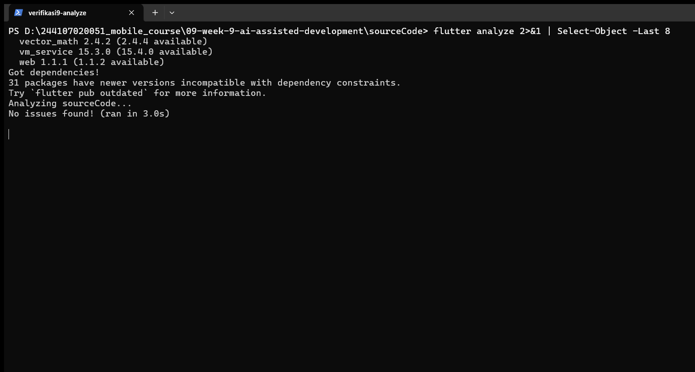
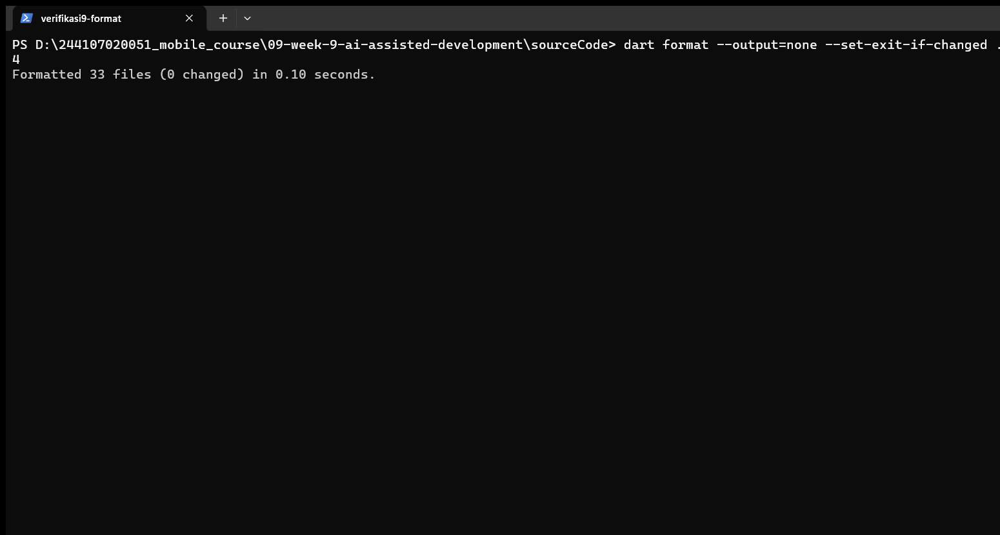
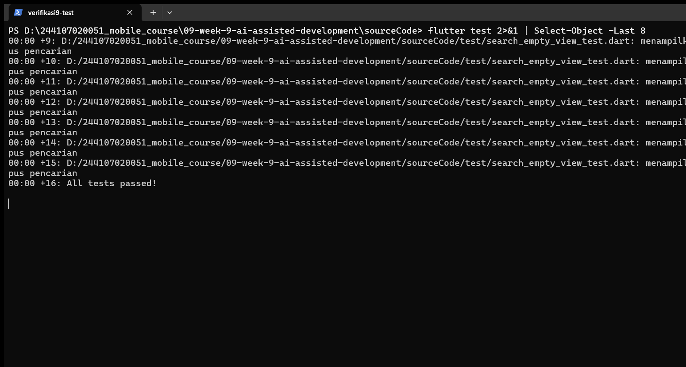
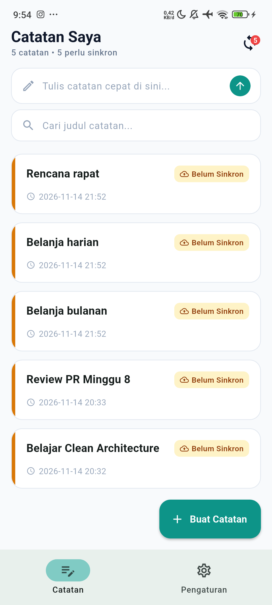
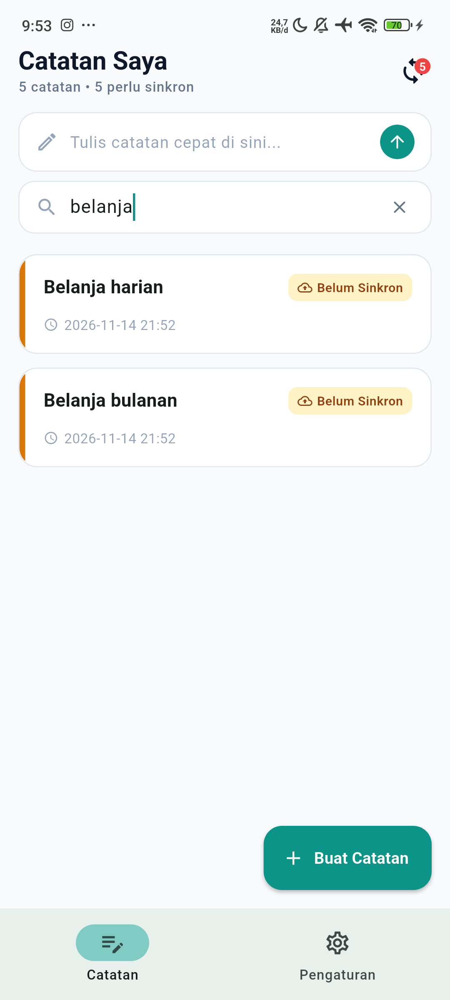
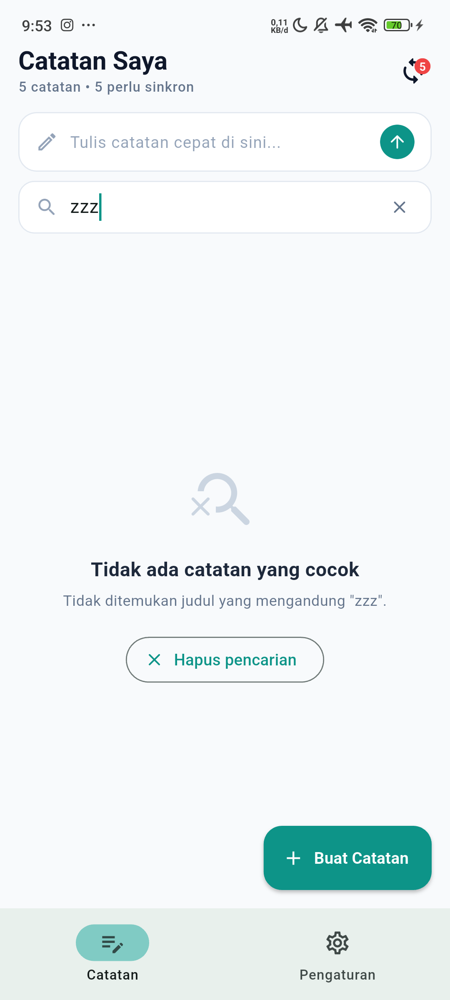

# Laporan Praktikum Minggu 9: AI-Assisted Development

**Nama Mahasiswa:** Ahmad Zainudin Fanani
**NIM:** 244107020051
**Mata Kuliah:** Pemrograman Mobile
**Basis Proyek:** `week5_offline_notes` — hasil refaktor Clean Architecture Minggu 7 dan review Minggu 8
**Tautan Repositori:** [244107020051_mobile_course](https://github.com/Ahmad-Zainudin-Fanani/244107020051_mobile_course)
**Issue:** [#8 Cari catatan berdasarkan judul dengan empty state](https://github.com/Ahmad-Zainudin-Fanani/244107020051_mobile_course/issues/8)
**Pull Request:** [#9 feat(notes): cari catatan berdasarkan judul dengan empty state](https://github.com/Ahmad-Zainudin-Fanani/244107020051_mobile_course/pull/9)
**Log AI:** [`docs/ai-log.md`](docs/ai-log.md)

---

## 1. Ringkasan

Minggu 9 bukan membuat aplikasi baru. Saya melanjutkan aplikasi catatan yang sudah lolos review Minggu 7–8, lalu menambahkan **satu fitur kecil dengan bantuan AI**: pencarian judul catatan beserta empty state ketika tidak ada hasil.

Fitur yang ditambahkan:

- Kolom cari di atas daftar catatan.
- Pencarian tidak peka huruf besar-kecil: `BELANJA` menemukan `Belanja bulanan`.
- Spasi di awal/akhir kata kunci diabaikan.
- Kata kunci kosong menampilkan seluruh catatan.
- Jika tidak ada yang cocok, muncul empty state dengan tombol **Hapus pencarian**.

Yang penting dari minggu ini bukan jumlah kode yang dihasilkan AI, tetapi jejak verifikasinya: prompt, draf awal, satu halusinasi yang dibuktikan, satu saran yang ditolak, dan bukti mesin hijau.

| Aspek | Target | Hasil |
| :--- | :--- | :---: |
| Fitur kecil di atas project lama | 1 fitur | **Lolos** — pencarian judul + empty state |
| Aturan pencarian di domain | Tidak di widget | **Lolos** — `searchNotesByTitle` |
| `flutter analyze` | 0 issue | **Lolos** — `No issues found!` |
| `dart format --set-exit-if-changed .` | 0 file berubah | **Lolos** — `33 files (0 changed)` |
| `flutter test` | Semua hijau | **Lolos** — 16 test |
| Dokumentasi AI | Prompt + halusinasi + tolak/terima | **Lolos** — [`docs/ai-log.md`](docs/ai-log.md) |
| Uji di perangkat nyata | Android 13 | **Lolos** — `2209116AG` / `5751c2fd0013` |

---

## 2. Prompt inti

Prompt lengkap dan output awal AI ada di [`docs/ai-log.md`](docs/ai-log.md). Intinya:

```text
Peran: senior Flutter developer yang disiplin pada Clean Architecture.
Konteks: feature-first (presentation -> domain <- data), Riverpod,
  GoRouter, SQLite. notesProvider adalah FutureProvider<List<Note>>.
  Domain tidak boleh impor Flutter.
Tugas: pencarian judul catatan + empty state, tidak peka huruf besar/kecil,
  abaikan spasi tepi, query kosong tampilkan semua.
Batas: jangan ubah arsitektur, jangan panggil SQLite dari widget,
  jangan tambah package, maks 80 baris kode inti.
Output: kode per layer + 3 test + cara uji.
```

Dua hal yang saya ubah dari prompt pertama: menyebut tipe konkret `notesProvider` (supaya AI tidak mengarang API) dan menegaskan batas layer (supaya filter tidak berakhir di `build()`).

---

## 3. Stack dan arsitektur

| Bagian | Teknologi |
| :--- | :--- |
| Framework | Flutter 3.47.2 / Dart 3.13.2 |
| State management | Riverpod 2 (`NotifierProvider`, `FutureProvider`, `Provider`) |
| Navigasi | GoRouter |
| Penyimpanan lokal | SQLite (`sqflite`) + `shared_preferences` |
| Arsitektur | feature-first Clean Architecture: `presentation -> domain <- data` |
| Test | `flutter_test` (unit + widget) |
| CI | GitHub Actions: analyze, format, test |

Alur data pencarian:

```text
TextField
  -> SearchQueryNotifier (state kata kunci)
  -> filteredNotesProvider
  -> searchNotesByTitle(notes, query)   // domain, murni
  -> ListView / SearchEmptyView
```

Tidak ada akses database dari widget, dan aturan filter tidak bergantung pada Flutter sehingga bisa diuji sebagai fungsi biasa.

---

## 4. Perubahan kode

Diff fitur terhadap baseline Minggu 8: **6 berkas, +265 / −5 baris**.

| Berkas | Perubahan |
| :--- | :--- |
| `lib/features/notes/domain/usecases/search_notes.dart` | **Baru** — fungsi murni `searchNotesByTitle` |
| `lib/features/notes/presentation/providers/notes_providers.dart` | `SearchQueryNotifier`, `searchQueryProvider`, `filteredNotesProvider` |
| `lib/features/notes/presentation/pages/notes_page.dart` | Kolom cari, daftar memakai hasil filter, tombol hapus |
| `lib/features/notes/presentation/widgets/search_empty_view.dart` | **Baru** — empty state yang bisa diuji |
| `test/search_notes_test.dart` | **Baru** — 5 unit test aturan pencarian |
| `test/search_empty_view_test.dart` | **Baru** — widget test empty state |

Baseline project Minggu 8 disalin lebih dulu pada commit `chore`, sehingga diff fitur tetap kecil dan mudah direview.

---

## 5. Cara menjalankan

```bash
cd 09-week-9-ai-assisted-development/sourceCode
flutter pub get
flutter run
```

Menjalankan pemeriksaan yang sama dengan CI:

```bash
flutter analyze
dart format --output=none --set-exit-if-changed .
flutter test
```

Uji manual:

1. Buka aplikasi, pastikan daftar catatan dan kolom cari tampil.
2. Buat catatan "Belanja bulanan", "Belanja harian", dan "Rencana rapat".
3. Cari `belanja` → dua catatan muncul.
4. Cari `  BELANJA  ` → hasil sama.
5. Cari `zzz` → empty state muncul; tekan **Hapus pencarian** → daftar penuh kembali.

---

## 6. Hasil pengujian

### 6.1 Quality gate

```text
$ flutter analyze
No issues found! (ran in 6.2s)

$ dart format --output=none --set-exit-if-changed .
Formatted 33 files (0 changed)

$ flutter test
00:00 +16: All tests passed!
```

<div align="center">
  
  <p><em>Gambar 6.1: Static analysis bersih tanpa issue.</em></p>
</div>

<div align="center">
  
  <p><em>Gambar 6.2: Seluruh berkas sesuai format resmi Dart.</em></p>
</div>

<div align="center">
  
  <p><em>Gambar 6.3: 16 test lulus, termasuk 5 test pencarian dan 1 widget test empty state.</em></p>
</div>

### 6.2 Bukti di perangkat

Diambil dari `2209116AG (mobile) • 5751c2fd0013 • android-arm64 • Android 13 (API 33)`.

<div align="center">
  
  <p><em>Gambar 6.4: Kolom cari di atas daftar catatan.</em></p>
</div>

<div align="center">
  
  <p><em>Gambar 6.5: Query <code>belanja</code> mengembalikan dua catatan.</em></p>
</div>

<div align="center">
  
  <p><em>Gambar 6.6: Query <code>zzz</code> menampilkan empty state dan tombol hapus pencarian.</em></p>
</div>

---

## 7. Temuan AI dan keputusan

Ringkasan; detail bukti ada di [`docs/ai-log.md`](docs/ai-log.md).

| Temuan / saran AI | Bukti | Keputusan |
| :--- | :--- | :--- |
| `notesProvider.notifier.search(value)` | `dart analyze` → `undefined_getter` pada `FutureProvider<List<Note>>` | **Ditolak**, tulis `SearchQueryNotifier` manual |
| Filter `contains()` peka huruf besar/kecil | 2 test merah: `BELANJA` → 0 hasil | **Diperbaiki** dengan `trim().toLowerCase()` |
| Tambah package `fuzzy` | Tidak perlu untuk kebutuhan *contains* | **Ditolak**, tanpa dependency baru |
| Pindahkan pencarian ke `WHERE title LIKE ?` | Memutus kontrak repository dan sulit diuji tanpa DB | **Ditolak**, tetap filter di domain murni |
| Empty state teks polos | Tidak bisa diuji sendiri | **Diterima + refactor** jadi `SearchEmptyView` |

---

## 8. Alur Git

```text
Issue #8
  -> branch feature/8-search-notes dari develop
  -> chore baseline -> feat domain+test -> feat UI -> docs screenshot -> docs laporan
  -> PR #9 "Closes #8" -> CI hijau -> merge commit ke develop
  -> release PR develop -> main -> back-merge main -> develop
```

Commit yang dibuat:

| Commit | Isi |
| :--- | :--- |
| `chore: bawa project Minggu 8 jadi bahan eksperimen Minggu 9` | Salinan baseline, tanpa perubahan perilaku |
| `feat: pindahkan aturan cari judul ke domain, lengkap dengan test batas` | Use case + 5 unit test |
| `feat: pasang kolom cari dan empty state di daftar catatan` | Provider, UI, widget empty state |
| `docs: simpan tangkapan layar pencarian dari HP 2209116AG` | 3 screenshot perangkat |
| `docs: catat prompt, halusinasi, dan keputusan AI` | `docs/ai-log.md`, README, bukti verifikasi |

Branch `main` tetap hanya menerima perubahan lewat PR rilis, dan `develop` menjadi target default PR fitur.

Bukti alur di GitHub: [`verif_issue.png`](Screenshots/verif_issue.png) (issue #8), [`verif_pr.png`](Screenshots/verif_pr.png) (checks PR #9), dan [`verif_ci.png`](Screenshots/verif_ci.png) (Actions run).

---

## 9. Struktur folder

```text
09-week-9-ai-assisted-development/
├── README.md
├── docs/
│   └── ai-log.md
├── Screenshots/
│   ├── app_notes_home.png
│   ├── app_search_results.png
│   ├── app_search_empty.png
│   ├── verif_flutter_analyze.png
│   ├── verif_dart_format.png
│   └── verif_flutter_test.png
└── sourceCode/
    ├── lib/features/notes/domain/usecases/search_notes.dart
    ├── lib/features/notes/presentation/providers/notes_providers.dart
    ├── lib/features/notes/presentation/pages/notes_page.dart
    ├── lib/features/notes/presentation/widgets/search_empty_view.dart
    └── test/search_notes_test.dart, test/search_empty_view_test.dart
```

---

## 10. Refleksi

Halusinasi yang paling jelas adalah `notesProvider.notifier.search()`. AI menulisnya tanpa ragu, padahal `FutureProvider` tidak punya notifier; analyzer yang membuktikannya. Yang lebih berbahaya justru bug yang lolos compile: filter case-sensitive. Dua test merah membuatnya terlihat jelas, dan perbaikannya hanya satu baris normalisasi.

Refactor terpenting adalah memindahkan aturan pencarian dari `build()` ke `searchNotesByTitle`. Sejak itu, lima kasus bisa diuji dalam milidetik tanpa widget atau database. Keputusan tersulit adalah menolak pencarian berbasis SQL yang terdengar lebih "scalable" — untuk ukuran data aplikasi ini, jalur itu hanya menambah bagian yang harus diuji tanpa manfaat nyata.

Ke depannya, saya akan tetap memakai AI untuk draf dan review awal, tetapi dengan dua kebiasaan yang terbukti berguna minggu ini: **tulis test sebelum percaya**, dan **minta bukti analyzer/grep untuk setiap API yang namanya tidak saya kenal**.
