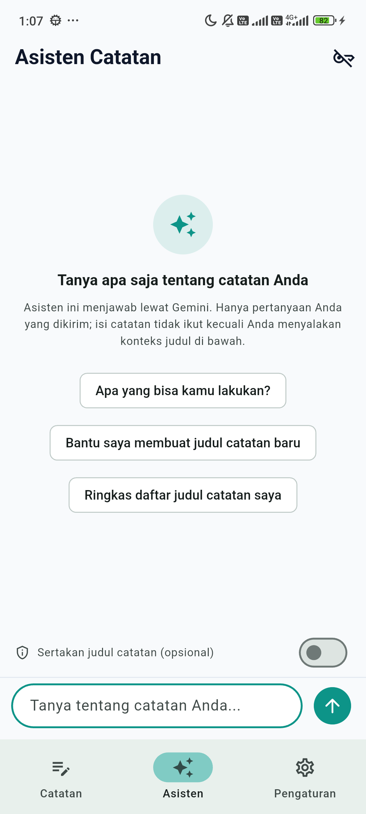
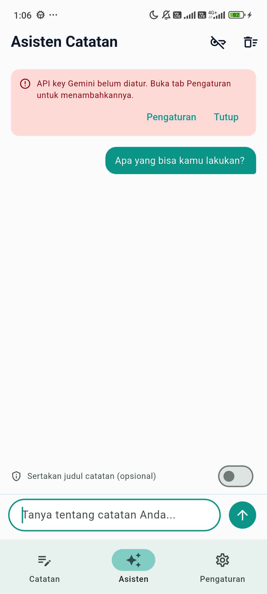
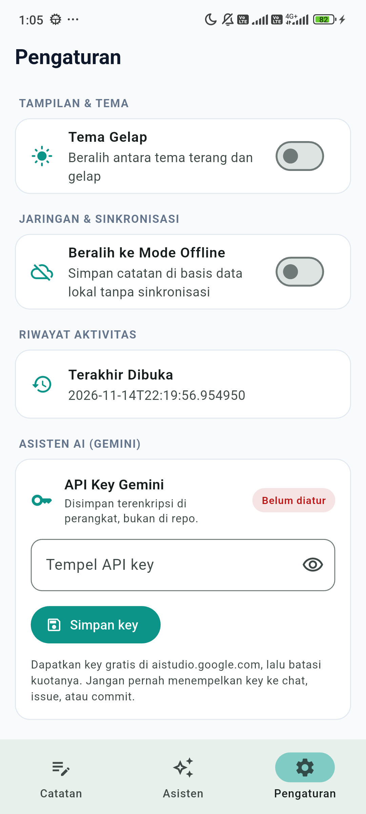
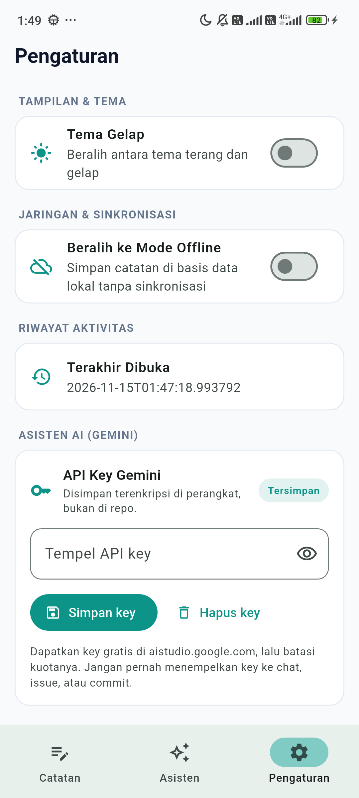
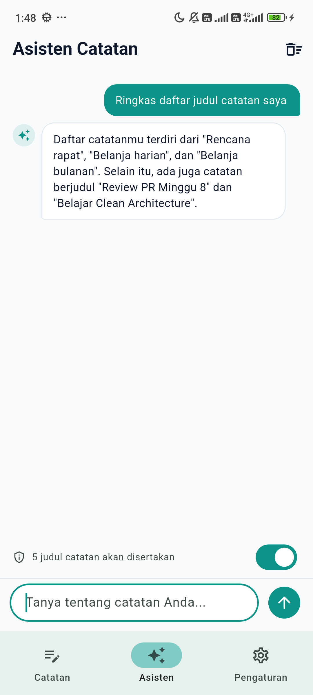
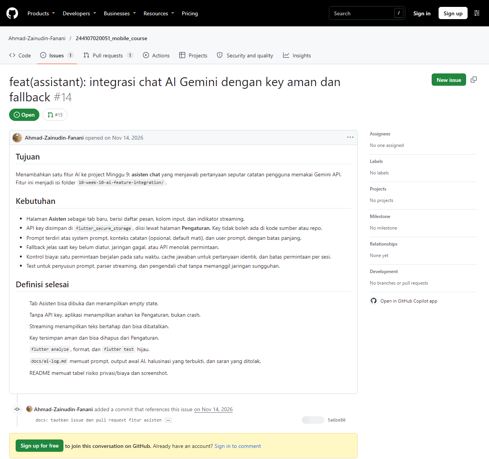
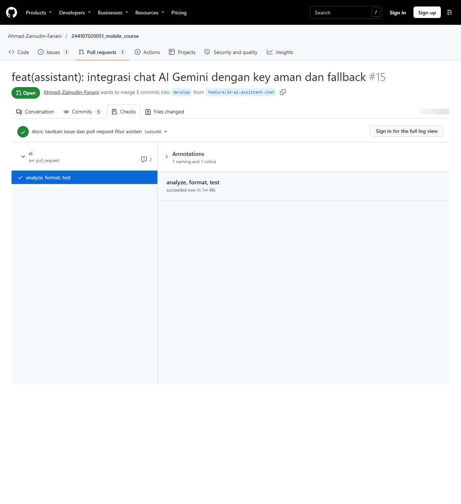
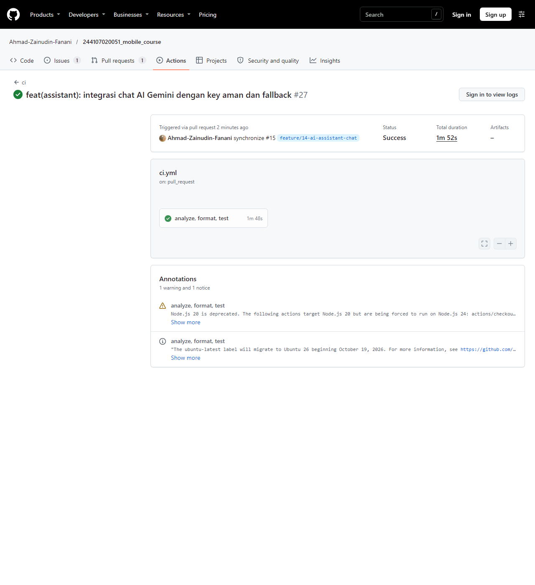

# Laporan Praktikum Minggu 10: Integrasi Fitur AI

**Nama Mahasiswa:** Ahmad Zainudin Fanani
**NIM:** 244107020051
**Mata Kuliah:** Pemrograman Mobile
**Basis Proyek:** `week5_offline_notes` — hasil Minggu 9 (`09-week-9-ai-assisted-development`)
**Tautan Repositori:** [244107020051_mobile_course](https://github.com/Ahmad-Zainudin-Fanani/244107020051_mobile_course)
**Issue:** [#14 Asisten chat AI Gemini dengan API key aman dan fallback](https://github.com/Ahmad-Zainudin-Fanani/244107020051_mobile_course/issues/14)
**Pull Request:** [#15 feat(assistant): integrasi chat AI Gemini dengan key aman dan fallback](https://github.com/Ahmad-Zainudin-Fanani/244107020051_mobile_course/pull/15)
**Log AI:** [`docs/ai-log.md`](docs/ai-log.md)

---

## 1. Ringkasan

Minggu 10 tidak membuat aplikasi baru. Saya menambahkan **satu fitur AI** ke aplikasi catatan yang sudah selesai di Minggu 5–9: **asisten chat** yang menjawab pertanyaan seputar catatan memakai Gemini API.

Fitur yang ditambahkan:

- Tab **Asisten** berisi percakapan, empty state dengan contoh pertanyaan, dan kolom input.
- Jawaban tampil **bertahap (streaming)** dan bisa dihentikan; teks yang sudah masuk dipertahankan.
- **API key Gemini** diisi lewat Pengaturan dan disimpan di `flutter_secure_storage`, bukan di kode/repo.
- **Konteks catatan bersifat opsional** (default mati). Hanya judul yang dikirim, bukan isi catatan.
- **Fallback jelas** saat key belum diatur, jaringan gagal, key ditolak, atau kuota habis.
- **Kontrol biaya**: satu permintaan berjalan pada satu waktu, cache untuk pertanyaan tanpa konteks, dan batas 20 permintaan per sesi.

| Aspek | Target | Hasil |
| :--- | :--- | :---: |
| Fitur AI di atas project lama | 1 fitur | **Lolos** — chat asisten Gemini |
| API key tidak masuk repo | Secure storage + input pengguna | **Lolos** — `flutter_secure_storage` |
| Streaming + bisa dihentikan | Tombol stop menutup koneksi | **Lolos** — `StreamSubscription.cancel()` |
| Privasi | Data minimal, opt-in | **Lolos** — hanya judul, default mati, `store: false` |
| `flutter analyze` | 0 issue | **Lolos** — `No issues found!` |
| `dart format --set-exit-if-changed .` | 0 file berubah | **Lolos** — `51 files (0 changed)` |
| `flutter test` | Semua hijau | **Lolos** — 43 test |
| Dokumentasi AI | Prompt + halusinasi + tolak/terima | **Lolos** — [`docs/ai-log.md`](docs/ai-log.md) |
| Uji di perangkat nyata | Android 13 | **Lolos** — `2209116AG` / `5751c2fd0013` |

---

## 2. Prompt inti

Prompt lengkap, output awal AI, dan bukti verifikasinya ada di [`docs/ai-log.md`](docs/ai-log.md). Intinya:

```text
Peran: senior Flutter developer yang disiplin pada Clean Architecture.
Konteks: feature-first (presentation -> domain <- data), Riverpod 3,
  GoRouter, sqflite. notesProvider adalah FutureProvider<List<Note>>.
  MainLayout punya NavigationBar 2 tab: Catatan dan Pengaturan.
Tugas: chat asisten dengan Gemini. Key diisi lewat Pengaturan dan disimpan
  di flutter_secure_storage; aplikasi tetap jalan tanpa key; jawaban
  streaming dan bisa dihentikan; konteks hanya judul, opsional, default mati.
Batas: jangan ubah arsitektur, jangan panggil HTTP dari widget, jangan taruh
  key di kode/repo, jangan kirim isi catatan, maks 4 berkas inti baru.
Output: struktur folder + kode per layer + daftar error + minimal 5 test.
```

Tiga hal yang saya tegaskan karena draf pertama salah ke arah sana: **hanya judul** (bukan isi catatan), **default mati** (bukan aktif), dan **stop harus menutup koneksi** (bukan hanya menghentikan loop).

Prompt review tahap kedua dipakai setelah fitur hijau, dengan fokus kebenaran, pembatalan stream, privasi, dan biaya. Dari situ muncul temuan blocker: pembatalan versi pertama tidak benar-benar menutup koneksi HTTP.

---

## 3. Stack dan arsitektur

| Bagian | Teknologi |
| :--- | :--- |
| Framework | Flutter 3.47.2 / Dart 3.13.2 |
| State management | Riverpod 3 (`NotifierProvider`, `FutureProvider`, `Provider`) |
| Navigasi | GoRouter + `NavigationBar` 3 tab |
| Penyimpanan lokal | SQLite (`sqflite`) + `shared_preferences` |
| Penyimpanan rahasia | `flutter_secure_storage` 11.2.0 (Keystore/Keychain) |
| Jaringan | `http` 1.6.0 + Server-Sent Events |
| AI | Gemini Interactions API, model `gemini-3.5-flash-lite` |
| Arsitektur | feature-first Clean Architecture: `presentation -> domain <- data` |
| Test | `flutter_test` (unit + widget), fake `AiAssistant` dan `ApiKeyStore` |
| CI | GitHub Actions: analyze, format, test |

Alur satu pertanyaan:

```text
TextField (AssistantPage)
  -> ChatController.send()
     -> ApiKeyStore.read()              // null -> banner ke Pengaturan
     -> buildSystemPrompt()             // judul opsional, maks 20
     -> AiAssistant.streamAnswer()      // GeminiAssistant, SSE
     -> cache (hanya tanpa konteks)
  -> ChatState.messages -> ChatBubble
```

Pemisahan layer:

| Layer | Isi | Tidak boleh |
| :--- | :--- | :--- |
| `domain` | `ChatMessage`, `AiAssistant`, `buildSystemPrompt`, `AssistantException` | impor Flutter, `http`, secure storage |
| `data` | `GeminiAssistant` (SSE), `SecureApiKeyStore` | menyentuh widget |
| `presentation` | provider, `ChatController`, halaman, widget | memanggil `http` langsung |

`AiAssistant` dan `ApiKeyStore` adalah kontrak, sehingga 26 test baru berjalan tanpa jaringan dan tanpa platform channel.

---

## 4. Perubahan kode

Diff fitur terhadap baseline Minggu 9: **21 berkas, +2047 / −1 baris** (di luar `pubspec.lock` dan registrant plugin hasil generate).

| Berkas | Perubahan |
| :--- | :--- |
| `lib/features/assistant/domain/entities/chat_message.dart` | **Baru** — model pesan + status streaming |
| `lib/features/assistant/domain/services/ai_assistant.dart` | **Baru** — kontrak `AiAssistant`, `AssistantException` |
| `lib/features/assistant/domain/usecases/build_system_prompt.dart` | **Baru** — prompt murni, batas 20 judul × 60 karakter |
| `lib/features/assistant/data/gemini_assistant.dart` | **Baru** — Interactions API + parser SSE + pemetaan error HTTP |
| `lib/features/assistant/data/api_key_store.dart` | **Baru** — secure storage di balik kontrak |
| `lib/features/assistant/presentation/providers/assistant_providers.dart` | **Baru** — `ChatController`, cache, batas sesi, cancel |
| `lib/features/assistant/presentation/pages/assistant_page.dart` | **Baru** — chat, banner error, saklar konteks |
| `lib/features/assistant/presentation/widgets/chat_bubble.dart` | **Baru** — gelembung pesan |
| `lib/features/assistant/presentation/widgets/assistant_empty_view.dart` | **Baru** — empty state + contoh pertanyaan |
| `lib/features/assistant/presentation/widgets/api_key_card.dart` | **Baru** — simpan/hapus key + status |
| `lib/router.dart` | Tab ketiga **Asisten** |
| `lib/pages/settings_page.dart` | Section `ASISTEN AI (GEMINI)` |
| `android/app/src/main/AndroidManifest.xml` | Izin `INTERNET` |
| `test/*` (7 berkas) | **Baru** — 26 test unit/widget |

Baseline Minggu 9 disalin lebih dulu pada commit `chore`, sehingga diff fitur tetap kecil dan mudah direview.

---

## 5. Cara menjalankan

```bash
cd 10-week-10-ai-feature-integration/sourceCode
flutter pub get
flutter run
```

Aplikasi **tetap berjalan tanpa API key**. Untuk mengaktifkan jawaban AI:

1. Buka [aistudio.google.com](https://aistudio.google.com) dan buat API key.
2. Batasi kuota key tersebut di Google Cloud Console (mis. 20 permintaan/hari) agar biaya terkendali.
3. Di aplikasi, buka tab **Pengaturan** → section **ASISTEN AI (GEMINI)** → tempel key → **Simpan key**.
4. Status berubah menjadi **Tersimpan**. Kembali ke tab **Asisten** dan kirim pertanyaan.
5. Untuk menghapus, tekan **Hapus key** dan konfirmasi.

Key tidak pernah ditulis ke kode, `pubspec.yaml`, file konfigurasi, atau commit. Key hanya hidup di Keystore/Keychain perangkat. Jika key bocor, hapus key itu di AI Studio dan buat yang baru.

Pemeriksaan yang sama dengan CI:

```bash
flutter analyze
dart format --output=none --set-exit-if-changed .
flutter test
```

Uji manual tanpa key:

1. Buka tab **Asisten** → empty state tampil dengan tiga contoh pertanyaan.
2. Tekan salah satu contoh → teks masuk ke kolom input.
3. Kirim → pertanyaan tampil, banner **"API key Gemini belum diatur"** muncul dengan tombol **Pengaturan**.
4. Buka Pengaturan, tempel key pendek → ditolak dengan pesan validasi.
5. Hapus percakapan lewat ikon tempat sampah → daftar pesan kosong.

Uji manual dengan key sungguhan:

1. Simpan key di Pengaturan → status **Tersimpan**, kolom dikosongkan.
2. Nyalakan **Sertakan judul catatan** → label berubah menjadi "5 judul catatan akan disertakan".
3. Kirim **"Ringkas daftar judul catatan saya"** → balasan menyebut kelima judul catatan perangkat.
4. Matikan saklar → label kembali "Sertakan judul catatan (opsional)" dan pertanyaan berikutnya tidak membawa judul.
5. Hapus key → status **Belum diatur**, tab Asisten kembali menampilkan fallback.
6. Cabut key tersebut di AI Studio karena sudah dipakai untuk pengujian.

---

## 6. Hasil pengujian

### 6.1 Quality gate

```text
$ flutter analyze
No issues found! (ran in 4.1s)

$ dart format --output=none --set-exit-if-changed .
Formatted 51 files (0 changed)

$ flutter test
00:02 +43: All tests passed!
```

26 test baru:

| Berkas | Jumlah | Cakupan |
| :--- | :---: | :--- |
| `test/build_system_prompt_test.dart` | 5 | aturan prompt, batas judul, pemotongan, blok konteks |
| `test/gemini_stream_test.dart` | 6 | bentuk request, event rusak, 401, 429, error mid-stream, stream kosong |
| `test/chat_controller_test.dart` | 8 | tanpa key, penggabungan chunk, konteks opt-in, cache, batas sesi, cancel, error, clear |
| `test/assistant_context_test.dart` | 4 | konteks mati, daftar termuat, daftar masih dimuat, saklar dimatikan lagi |
| `test/assistant_empty_view_test.dart` | 1 | contoh pertanyaan meneruskan pilihan |
| `test/api_key_card_test.dart` | 2 | simpan key valid, tolak key pendek |

### 6.2 Bukti di perangkat

Diambil dari `2209116AG (mobile) • 5751c2fd0013 • android-arm64 • Android 13 (API 33)`.

<div align="center">
  
  <p><em>Gambar 6.1: Tab Asisten — empty state, contoh pertanyaan, saklar konteks mati, dan ikon key-off karena key belum diatur.</em></p>
</div>

<div align="center">
  
  <p><em>Gambar 6.2: Fallback tanpa API key — pertanyaan tetap tampil, banner menjelaskan langkah berikutnya, aplikasi tidak crash.</em></p>
</div>

<div align="center">
  
  <p><em>Gambar 6.3: Kartu API key di Pengaturan — status "Belum diatur", kolom key tersembunyi, dan tombol simpan.</em></p>
</div>

<div align="center">
  
  <p><em>Gambar 6.4: Setelah key disimpan — status berubah menjadi "Tersimpan", kolom dikosongkan, dan key tidak pernah ditampilkan.</em></p>
</div>

<div align="center">
  
  <p><em>Gambar 6.5: Balasan Gemini sungguhan dengan konteks lima judul catatan perangkat.</em></p>
</div>

Verifikasi dengan key sungguhan juga menemukan satu bug nyata: percobaan pertama membalas "tidak ada judul catatan yang diberikan" meski saklar konteks menyala. Penyebabnya `notesProvider` bersifat `autoDispose` dan `NotesPage` dibuang saat tab berganti, sehingga daftar judul masih loading ketika tombol kirim ditekan. Perbaikan dan 4 test regresinya ada di Issue [#17](https://github.com/Ahmad-Zainudin-Fanani/244107020051_mobile_course/issues/17).

Key yang dipakai untuk verifikasi sudah dihapus dari perangkat setelah pengujian. Karena key tersebut sempat dibagikan di luar aplikasi, key itu harus dicabut di AI Studio dan diganti dengan yang baru; tidak ada key yang tersimpan di repo, dokumentasi, atau screenshot.

---

## 7. Privasi, biaya, dan risiko

| Risiko | Dampak | Mitigasi yang diterapkan |
| :--- | :--- | :--- |
| API key bocor dari repo | Kredit API dipakai orang lain | Key hanya di `flutter_secure_storage`; tidak ada key di kode, test, atau commit; input lewat Pengaturan |
| Key bocor dari perangkat | Penyalahgunaan kuota | Key bisa dihapus dari Pengaturan; pengguna diarahkan membatasi kuota di Google Cloud |
| Key terekspos saat pengujian manual | Key dipakai orang lain | Key uji dihapus dari perangkat setelah verifikasi dan wajib dicabut di AI Studio; key baru tidak pernah ditempel ke chat/issue/commit |
| Isi catatan pribadi terkirim ke pihak ketiga | Kebocoran data pengguna | Isi catatan **tidak pernah** dikirim; hanya judul, maksimal 20, dan hanya bila saklar dinyalakan (default mati) |
| Riwayat percakapan tersimpan di server AI | Data menetap di luar kendali | `store: false` pada setiap request; riwayat hanya di memori aplikasi |
| Biaya membengkak karena pemakaian berulang | Tagihan tak terduga | Batas 20 permintaan per sesi, satu permintaan aktif pada satu waktu, `max_output_tokens: 512`, cache untuk pertanyaan tanpa konteks |
| Permintaan berulang saat error/429 | Rate limit makin parah | Tidak ada retry otomatis; pesan spesifik + percobaan ulang manual |
| Jawaban AI salah atau mengarang | Keputusan pengguna salah | System prompt melarang mengarang isi catatan dan meminta pengguna membuka catatan terkait; jawaban bisa dihentikan dan dibersihkan |
| Prompt injection dari judul catatan | Perilaku AI menyimpang | Judul hanya dikirim sebagai daftar berbutir setelah aturan wajib; tidak ada instruksi dari judul yang dieksekusi |
| Kegagalan jaringan / server | Aplikasi terasa rusak | Timeout 30 detik, pesan per status (401/403/404/429/5xx), banner yang bisa ditutup |
| Data sensitif di screenshot/dokumentasi | Kebocoran saat publikasi | Screenshot hanya memuat catatan contoh tanpa data pribadi; key tidak pernah difoto |

---

## 8. Temuan AI dan keputusan

Ringkasan; bukti lengkap ada di [`docs/ai-log.md`](docs/ai-log.md).

| Temuan / saran AI | Bukti | Keputusan |
| :--- | :--- | :--- |
| `gemini-pro:generateContent` (contoh modul) | Halaman model resmi: `gemini-pro` 0 kemunculan; `gemini-2.5-flash` deprecated; dokumentasi kini memakai `/v1beta/interactions` | **Ditolak**, pakai `gemini-3.5-flash-lite` + Interactions API |
| `AsyncValue.valueOrNull` di widget | `flutter analyze` → `undefined_getter` pada `AsyncValue<bool>`; Riverpod 3 hanya punya `value` | **Diperbaiki** menjadi `.value` |
| Cancel dengan `await for` + flag | Lolos compile dan test biasa, tetapi koneksi tetap terbuka dan token tetap dihitung | **Ditolak**, ganti `StreamSubscription` + `Completer` |
| Simpan key di `SharedPreferences` | Plaintext dan bisa ikut backup | **Ditolak**, pakai `flutter_secure_storage` |
| Kirim isi catatan sebagai konteks | Data pribadi keluar dari perangkat | **Ditolak**, hanya judul + opt-in |
| Retry otomatis tanpa batas | Memperburuk rate limit dan biaya | **Ditolak**, percobaan ulang manual + batas sesi |
| `temperature`/`top_p` untuk konsistensi | Dokumentasi: Gemini 4 & 3.6+ mengabaikan parameter itu | **Ditolak**, hanya `max_output_tokens` |
| Jawaban demo saat key belum ada | Menampilkan jawaban palsu sebagai AI | **Ditolak**, empty state + banner jujur |
| Konteks judul kosong di perangkat | Saklar menyala tetapi AI menjawab "tidak ada judul"; `notesProvider` autoDispose dimulai ulang saat tab berganti | **Diperbaiki** dengan `assistantContextTitlesProvider` + 4 test regresi (Issue #17, PR #18) |

---

## 9. Alur Git

```text
Issue #14
  -> branch feature/14-ai-assistant-chat dari develop
  -> chore: salin baseline Minggu 9
  -> feat: domain + klien Gemini + secure storage
  -> feat: tab Asisten + Pengaturan + test alur chat
  -> docs: ai-log + README + screenshot perangkat
  -> PR #15 "Closes #14" -> CI hijau -> merge ke develop
  -> release PR #16 develop -> main -> back-merge main -> develop

Issue #17 (ditemukan saat uji dengan key sungguhan)
  -> branch fix/17-assistant-context-titles dari develop
  -> test regresi konteks judul -> provider turunan + label jumlah judul
  -> PR #18 -> CI hijau -> merge ke develop
  -> release PR develop -> main -> back-merge main -> develop
```

Commit yang dibuat:

| Commit | Isi |
| :--- | :--- |
| `chore: salin baseline project Minggu 9 ke folder Minggu 10` | Salinan 164 berkas, tanpa perubahan perilaku |
| `feat(assistant): tambah kontrak domain, klien Gemini, dan penyimpanan key` | Domain, SSE client, secure storage, dependensi |
| `feat(assistant): pasang tab Asisten, pengaturan key, dan test alur chat` | UI, navigasi, manifest, 22 test |
| `docs: catat prompt, halusinasi, dan keputusan AI` | `docs/ai-log.md` + README + screenshot |
| `docs: tautkan issue dan pull request fitur asisten` | Tautan Issue #14 dan PR #15 |
| `docs: simpan bukti issue, PR, dan CI dari GitHub` | `verif_issue.png`, `verif_pr.png`, `verif_ci.png` |
| `fix(assistant): kirim judul catatan walau tab Catatan sudah ditutup` | Provider konteks + label jumlah judul + 4 test regresi |
| `docs: catat verifikasi dengan key sungguhan dan bug konteks` | Screenshot balasan nyata, angka test baru, Issue #17 |

`main` tetap hanya menerima perubahan lewat PR rilis, dan `develop` menjadi target default PR fitur.

Bukti alur di GitHub:

<div align="center">
  
  <p><em>Gambar 9.1: Issue #14 sebagai titik awal branch fitur.</em></p>
</div>

<div align="center">
  
  <p><em>Gambar 9.2: PR #15 — check <code>analyze, format, test</code> hijau.</em></p>
</div>

<div align="center">
  
  <p><em>Gambar 9.3: GitHub Actions run #27 selesai sukses dalam 1m 52s.</em></p>
</div>

---

## 10. Struktur folder

```text
10-week-10-ai-feature-integration/
├── README.md
├── docs/
│   └── ai-log.md
├── Screenshots/
│   ├── assistant_empty.png
│   ├── assistant_no_key.png
│   ├── assistant_reply.png
│   ├── settings_api_key.png
│   ├── settings_key_saved.png
│   ├── verif_issue.png
│   ├── verif_pr.png
│   └── verif_ci.png
└── sourceCode/
    ├── lib/features/assistant/
    │   ├── domain/{entities,services,usecases}/
    │   ├── data/{gemini_assistant,api_key_store}.dart
    │   └── presentation/{pages,providers,widgets}/
    ├── lib/router.dart
    ├── lib/pages/settings_page.dart
    └── test/{build_system_prompt,gemini_stream,chat_controller,
             assistant_empty_view,api_key_card}_test.dart
```

---

## 11. Refleksi

**Halusinasi paling menonjol** adalah `gemini-pro:generateContent` yang masih dipakai contoh modul. Nama model itu sudah tidak ada di halaman resmi, dan bentuk endpoint-nya sudah berganti ke Interactions API. Saya menemukannya bukan dengan membaca sekilas, tetapi dengan menghitung kemunculan string di halaman dokumentasi dan mencocokkan setiap parameter (`store`, `system_instruction`, `alt=sse`, `x-goog-api-key`) sebelum menulis kode.

**Kesalahan yang paling mahal adalah yang tidak menghasilkan error.** Pembatalan versi pertama lolos compile dan lolos test teks, tetapi tetap membuka koneksi dan menghitung token sampai stream selesai. Untuk fitur berbayar, "berhenti" harus berarti koneksi ditutup. Perbaikannya kecil, dampaknya besar: biaya berhenti saat pengguna berhenti.

**Keputusan tersulit** adalah menolak fallback demo. Demo akan membuat screenshot terlihat lebih meyakinkan, tetapi berarti memalsukan jawaban AI. Saya memilih empty state dan banner yang jujur, lalu menutupi jalur jaringan dengan test parser yang deterministik.

**Yang akan saya bawa ke Minggu 11:** test untuk kasus gagal dan pembatalan ditulis lebih dulu, bukan sesudah fitur "terlihat jalan". Dua bug desain minggu ini akan tertangkap di menit pertama bila urutannya dibalik.

**Pelajaran tambahan dari verifikasi dengan key sungguhan:** 39 test hijau tidak menjamin integrasi antarhalaman benar. Bug konteks judul hanya muncul karena `NotesPage` sudah dibuang saat tab Asisten dibuka, sesuatu yang tidak pernah terjadi di unit test provider. Satu screenshot balasan AI yang menyebut "tidak ada judul" cukup untuk membongkar asumsi itu, dan 4 test regresi membuatnya tidak terulang.
