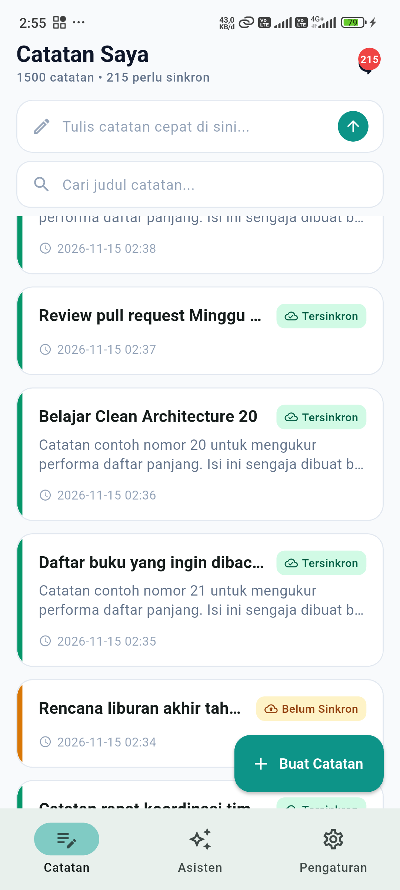
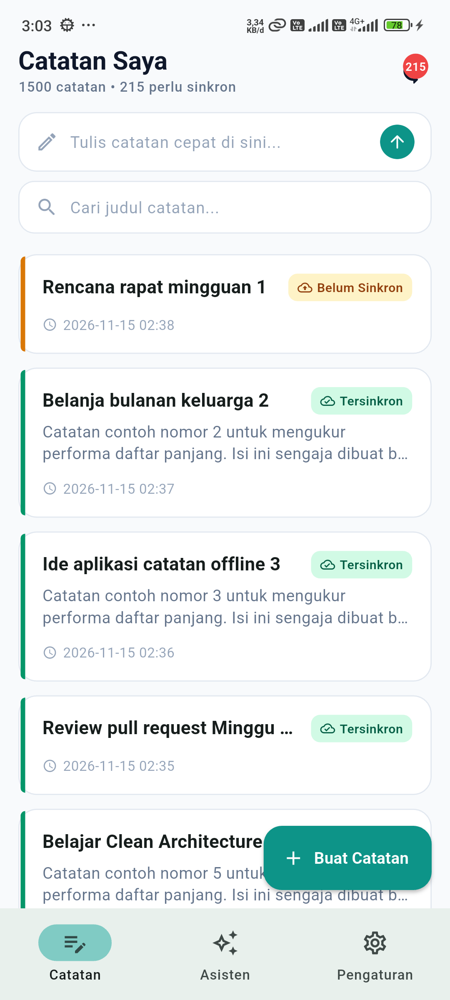
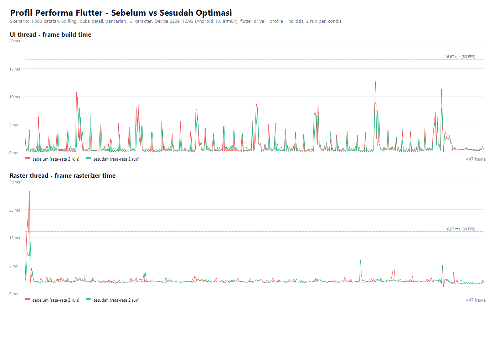
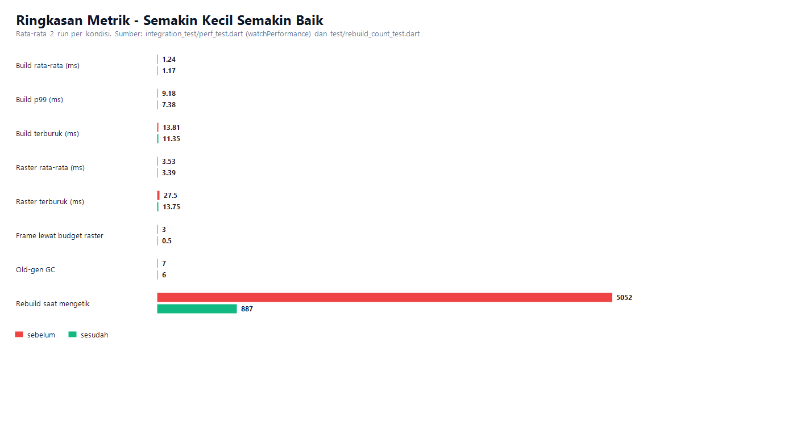

# Laporan Praktikum Minggu 11: Optimasi Performa

**Nama Mahasiswa:** Ahmad Zainudin Fanani
**NIM:** 244107020051
**Mata Kuliah:** Pemrograman Mobile
**Basis Proyek:** `week5_offline_notes` — hasil Minggu 10 (`10-week-10-ai-feature-integration`)
**Tautan Repositori:** [244107020051_mobile_course](https://github.com/Ahmad-Zainudin-Fanani/244107020051_mobile_course)
**Issue:** [#23 perf: optimasi performa aplikasi catatan Minggu 11](https://github.com/Ahmad-Zainudin-Fanani/244107020051_mobile_course/issues/23)
**Pull Request:** [#24 perf: optimasi performa aplikasi catatan Minggu 11](https://github.com/Ahmad-Zainudin-Fanani/244107020051_mobile_course/pull/24)
**Rilis ke `main`:** [#25 release: praktikum Minggu 11 - optimasi performa](https://github.com/Ahmad-Zainudin-Fanani/244107020051_mobile_course/pull/25)
**Laporan performa lengkap:** [`docs/performance-report.md`](docs/performance-report.md)
**Temuan profiling:** [`docs/performance-findings.md`](docs/performance-findings.md)

---

## 1. Ringkasan

Minggu 11 tidak menambah fitur baru. Saya **mengukur** aplikasi catatan yang
sudah selesai di Minggu 5–10, menemukan bottleneck-nya, lalu memperbaikinya —
dan membuktikan perbaikannya dengan pengukuran ulang, bukan dengan perasaan.

Hasil utamanya:

| Aspek | Sebelum | Sesudah |
| :--- | ---: | ---: |
| Rebuild saat mengetik 13 karakter | 5.052 | **887** |
| Rebuild halaman per ketikan | 13 | **0** |
| Frame raster terburuk | 27,5 ms | **13,75 ms** |
| Frame melewati budget raster | 3 | **1 dan 0** |
| Frame build p99 | 9,18 ms | **7,38 ms** |

Semua angka berasal dari **2 run per kondisi** di `2209116AG` (Android 13,
arm64), mode `--profile`, dengan 1.500 catatan di SQLite. Detail dan batasan
pengukurannya ada di [`docs/performance-report.md`](docs/performance-report.md).

| Target modul | Hasil |
| :--- | :---: |
| Baseline profiling dengan DevTools/`--profile` | **Lolos** — 2 run tersimpan di `docs/measurements/` |
| Identifikasi minimal 3 masalah | **Lolos** — 5 temuan terukur |
| Terapkan minimal 3 optimasi | **Lolos** — 5 optimasi (rebuild, statistik, debounce, layout, pagination) |
| Verifikasi before/after | **Lolos** — p99, frame terburuk, dan rebuild membaik konsisten |
| Memory profiling | **Lolos** — RSS 5x navigasi, tanpa indikasi leak |
| `flutter analyze` | **Lolos** — `No issues found!` |
| `dart format --set-exit-if-changed` | **Lolos** — `58 files (0 changed)` |
| `flutter test` | **Lolos** — 44 test |
| Uji di perangkat nyata | **Lolos** — `2209116AG` / `5751c2fd0013` |

---

## 2. Metodologi

| Bagian | Nilai |
| :--- | :--- |
| Perangkat | `2209116AG` — Android 13 (API 33), arm64 |
| Flutter / Dart | 3.47.2 / 3.13.2 |
| Mode | `flutter drive --profile --no-dds` |
| Data uji | 1.500 catatan diseed oleh test ke SQLite |
| Jumlah run | 2 sebelum, 2 sesudah |
| Alat ukur frame | `IntegrationTestWidgetsFlutterBinding.watchPerformance` |
| Alat ukur rebuild | `debugOnRebuildDirtyWidget` di widget test |
| Alat ukur memori | `ProcessInfo.currentRss` sebelum/sesudah 5x navigasi |

Dua keputusan metodologi yang penting:

1. **`--profile`, bukan `--debug`.** Mode debug punya overhead besar dan angka
   frame-nya tidak representatif.
2. **`--no-dds` wajib.** Tanpa flag itu `watchPerformance` gagal:
   `Failed to connect to VM Service ... This may happen if DDS is enabled`.
   Baris perintah lengkap ada di §7.

Skenario yang diukur sama untuk kedua kondisi: buka daftar → fling 6x → buka
detail → kembali → cari `belanja` → kosongkan → ketik `rencana rapat` 13
karakter → buka-tutup detail 5x.

---

## 3. Temuan baseline

Detail ada di [`docs/performance-findings.md`](docs/performance-findings.md).
Lima masalah yang benar-benar terukur:

| # | Temuan | Bukti |
| :--- | :--- | :--- |
| 1 | Satu ketikan membangun ulang seluruh halaman | 388,6 elemen rebuild per ketikan |
| 2 | Statistik daftar dipindai ulang setiap build | `where(dirty).length` di `build` |
| 3 | Penyaringan tanpa jeda | 13 karakter = 13 pass atas 1.500 judul |
| 4 | `IntrinsicHeight` + `ClipRRect` per item | layout 2x + `saveLayer` per item |
| 5 | Daftar mengelola seluruh 1.500 item | tanpa pagination, keepAlive per item |

Baseline lengkap (rata-rata 2 run):

| Metrik | Baseline |
| :--- | ---: |
| Frame build rata-rata / p99 / terburuk | 1,24 / 9,18 / 13,81 ms |
| Frame raster rata-rata / terburuk | 3,53 / 27,50 ms |
| Frame melewati budget raster | 3 dari ±447 |
| Rebuild total (13 ketikan) | 5.052 |
| RSS setelah 5x buka-tutup detail | +4,5 MB |

---

## 4. Optimasi yang diterapkan

### 4.1 `const` dan pemisahan widget — halaman tidak lagi ikut rebuild

`NotesPage` dipecah menjadi empat widget dengan ketergantungan masing-masing:

| Widget | Mengamati |
| :--- | :--- |
| `NotesAppBar` | `noteStatsProvider` |
| `QuickAddBar` | — |
| `NoteSearchField` | controller teks (hanya ikon clear) |
| `NotesList` | `filteredNotesProvider`, `searchQueryProvider` |

`NotesPage` tidak lagi mengamati provider data apa pun, jadi rebuild-nya **0**
saat mengetik. Sebelumnya setiap karakter membangun ulang AppBar, dua kolom
input, dan seluruh daftar.

### 4.2 `select` dan provider turunan untuk statistik

```dart
final noteStatsProvider = Provider.autoDispose<({int total, int dirty})>((ref) {
  final notes = ref.watch(notesProvider).value ?? const <Note>[];
  var dirty = 0;
  for (final note in notes) {
    if (note.dirty) dirty++;
  }
  return (total: notes.length, dirty: dirty);
});
```

Pemindaian 1.500 catatan kini terjadi saat data berubah, bukan setiap build.
Karena nilainya record, Riverpod membandingkan isi dan tidak memicu rebuild
bila angkanya sama.

### 4.3 Debounce 250 ms pada kolom pencarian

```dart
void _onSearchChanged(String value) {
  _searchTimer?.cancel();
  if (value.isEmpty) {
    ref.read(searchQueryProvider.notifier).clear();
    return;
  }
  _searchTimer = Timer(_searchDebounce, () {
    if (!mounted) return;
    ref.read(searchQueryProvider.notifier).update(value);
  });
}
```

Diukur dengan `dart run tool/search_bench.dart` (1.500 judul):
**13 pass = 1.687 µs → 1 pass = 129 µs, hemat 92,4% per burst mengetik.**

### 4.4 `RepaintBoundary`/layout: hapus `IntrinsicHeight` dan `ClipRRect`

Garis aksen kiri yang sebelumnya memaksa `IntrinsicHeight` (layout dua kali)
kini digambar sebagai `Positioned` di dalam `Stack`:

```dart
Stack(
  children: [
    Positioned(left: 1, top: 1, bottom: 1, width: 4, child: DecoratedBox(...)),
    Padding(padding: const EdgeInsets.only(left: 4), child: InkWell(...)),
  ],
)
```

`ClipRRect` (satu `saveLayer` per item) ikut dihapus. Hasilnya frame raster
terburuk turun dari 27,50 ms ke **13,75 ms**.

### 4.5 Pagination + `addAutomaticKeepAlives: false`

`NotesList` merender 60 item per halaman, menambah 60 item saat sisa scroll
< 400 px, dan tidak membungkus item dengan keep-alive karena `NoteTile` tidak
punya state.

### 4.6 Yang sengaja tidak dioptimasi

| Kategori | Keputusan | Alasan |
| :--- | :--- | :--- |
| Optimasi gambar | Dilewati | Aplikasi tidak menampilkan gambar jaringan |
| `CachedNetworkImage` | Tidak ditambahkan | Dependensi baru tanpa frame yang membaik |
| Caching jaringan catatan | Tidak diubah | Catatan sepenuhnya lokal (SQLite) |
| Caching halaman Posts | Tidak diubah | Sudah cache-first sejak Minggu 5 |

---

## 5. Hasil verifikasi

### 5.1 Frame time (rata-rata 2 run)

| Metrik | Sebelum | Sesudah | Perubahan |
| :--- | ---: | ---: | ---: |
| Build rata-rata | 1,24 ms | 1,17 ms | −5,6% (dalam noise) |
| Build p99 | 9,18 ms | **7,38 ms** | **−19,6%** |
| Build terburuk | 13,81 ms | **11,35 ms** | **−17,8%** |
| Raster rata-rata | 3,53 ms | 3,39 ms | −4,0% |
| Raster terburuk | 27,50 ms | **13,75 ms** | **−50,0%** |
| Frame lewat budget raster | 3 | **1 dan 0** | konsisten turun |
| Old-gen GC | 7 | 6 | −14,3% |

Rata-rata hanya bergerak sedikit karena `ListView.builder` memang sudah lazy.
Yang berubah besar adalah **ekor distribusi** — dan itu yang menentukan jank.

### 5.2 Rebuild (deterministik)

| Metrik | Sebelum | Sesudah |
| :--- | ---: | ---: |
| Rebuild `NotesPage` | 13 | **0** |
| Rebuild `NoteTile` | 78 | **6** |
| Total rebuild | 5.052 | **887** |
| Per ketikan | 388,6 | **68,2** |

Angka ini dijaga oleh test: `test/rebuild_count_test.dart` gagal bila
`NotesPage` kembali ikut rebuild atau total rebuild melewati 1.200.

### 5.3 Memori

| Run | Sebelum | Sesudah | Delta |
| :--- | ---: | ---: | ---: |
| Baseline 1 | 236 MB | 240 MB | +3 MB |
| Baseline 2 | 234 MB | 240 MB | +6 MB |
| Setelah 1 | 239 MB | 242 MB | +2 MB |
| Setelah 2 | 231 MB | 237 MB | +5 MB |

Tidak ada indikasi kebocoran di kedua kondisi. Selisih antar-run lebih besar
daripada selisih antar-kondisi, jadi saya **tidak** mengklaim optimasi memori.
Yang diperiksa: semua controller di-`dispose()`, listener `ScrollController`
dilepas sebelum dispose, dan timer debounce dibatalkan.

### 5.4 Bukti di perangkat

<div align="center">
  
  <p><em>Gambar 5.1: Sebelum — 1.500 catatan, 215 belum sinkron.</em></p>
</div>

<div align="center">
  
  <p><em>Gambar 5.2: Sesudah — tampilan sama, biaya membangunnya yang berbeda.</em></p>
</div>

<div align="center">
  
  <p><em>Gambar 5.3: Frame build dan raster per frame, rata-rata 2 run. Garis putus-putus = budget 16,67 ms (60 FPS).</em></p>
</div>

<div align="center">
  
  <p><em>Gambar 5.4: Ringkasan metrik sebelum vs sesudah.</em></p>
</div>

### 5.5 Quality gate

```text
$ flutter analyze
No issues found! (ran in 2.9s)

$ dart format --set-exit-if-changed lib test integration_test tool
Formatted 58 files (0 changed)

$ flutter test
00:06 +44: All tests passed!
```

---

## 6. Perubahan kode

Diff terhadap baseline Minggu 10 (di luar `pubspec.lock` dan berkas generate):

| Berkas | Perubahan |
| :--- | :--- |
| `lib/features/notes/presentation/pages/notes_page.dart` | **Dirombak** — 526 → 239 baris; hanya menyusun empat widget + dialog tambah catatan |
| `lib/features/notes/presentation/widgets/notes_app_bar.dart` | **Baru** — AppBar + badge + aksi sinkronisasi, hanya mengamati `noteStatsProvider` |
| `lib/features/notes/presentation/widgets/notes_list.dart` | **Baru** — daftar, pagination, empty state, hapus, navigasi detail |
| `lib/features/notes/presentation/widgets/note_search_field.dart` | **Baru** — kolom cari; hanya ikon clear yang ikut rebuild |
| `lib/features/notes/presentation/widgets/quick_add_bar.dart` | **Baru** — kolom input cepat, tanpa ketergantungan provider |
| `lib/features/notes/presentation/providers/notes_providers.dart` | **Tambah** `noteStatsProvider` |
| `lib/features/notes/presentation/widgets/note_tile.dart` | `IntrinsicHeight` + `ClipRRect` → `Stack` + `Positioned` |
| `integration_test/perf_test.dart` | **Baru** — skenario profiling + pengukuran RSS |
| `test_driver/integration_test.dart` | **Baru** — driver `flutter drive` |
| `test/rebuild_count_test.dart` | **Baru** — penghitung rebuild + penjaga regresi |
| `tool/search_bench.dart` | **Baru** — benchmark biaya penyaringan |
| `pubspec.yaml` | `integration_test` (SDK) |
| `docs/`, `Screenshots/` | Laporan, data mentah, grafik, screenshot |

Tidak ada perubahan pada domain, data, maupun fitur Asisten AI dari Minggu 10.

---

## 7. Cara menjalankan dan mengukur ulang

```bash
cd 11-week-11-performance-optimization/sourceCode
flutter pub get
flutter run
```

Profiling di perangkat (butuh perangkat/emulator Android):

```bash
flutter drive --profile --no-dds -d 5751c2fd0013 \
  --driver=test_driver/integration_test.dart \
  --target=integration_test/perf_test.dart
```

Hasil mentah ditulis ke `build/integration_response_data.json`. Salin ke
`docs/measurements/` bila ingin membandingkan dengan laporan ini.

Uji rebuild dan benchmark:

```bash
flutter test test/rebuild_count_test.dart
dart run tool/search_bench.dart
```

Membuat ulang grafik (PowerShell 5.1+):

```powershell
& docs/tools/plot_perf.ps1 `
  -Before @("docs/measurements/baseline.json","docs/measurements/baseline-2.json") `
  -After  @("docs/measurements/after.json","docs/measurements/after-2.json") `
  -BeforeRebuilds 5052 -AfterRebuilds 887 `
  -OutDir Screenshots
```

Membuat screenshot dengan 1.500 catatan di perangkat:

```bash
python docs/tools/seed_device_db.py offline_notes.db
adb push offline_notes.db /data/local/tmp/offline_notes.db
adb shell "run-as com.example.week5_offline_notes cp /data/local/tmp/offline_notes.db databases/offline_notes.db"
adb shell am start -n com.example.week5_offline_notes/.MainActivity
```

---

## 8. Struktur folder

```text
11-week-11-performance-optimization/
├── README.md
├── docs/
│   ├── performance-findings.md      # baseline + 5 temuan
│   ├── performance-report.md        # laporan lengkap + trade-off
│   ├── measurements/                # data mentah 2 run per kondisi
│   │   ├── baseline.json
│   │   ├── baseline-2.json
│   │   ├── after.json
│   │   ├── after-2.json
│   │   └── memory.json
│   └── tools/
│       ├── plot_perf.ps1            # grafik dari JSON
│       └── seed_device_db.py        # DB 1.500 catatan untuk screenshot
├── Screenshots/
│   ├── 01-daftar-1500-catatan-sebelum.png
│   ├── 02-daftar-1500-catatan-sesudah.png
│   ├── 03-frame-timings.png
│   └── 04-ringkasan-metrik.png
└── sourceCode/
    ├── lib/features/notes/presentation/
    │   ├── pages/notes_page.dart
    │   ├── providers/notes_providers.dart
    │   └── widgets/{notes_app_bar,notes_list,note_search_field,quick_add_bar,note_tile}.dart
    ├── integration_test/perf_test.dart
    ├── test_driver/integration_test.dart
    ├── test/rebuild_count_test.dart
    └── tool/search_bench.dart
```

---

## 9. Refleksi

### 9.1 Jawaban pertanyaan refleksi modul

**Optimasi mana yang memberikan dampak terbesar dan mengapa?**
Isolasi rebuild dan debounce. Keduanya menghapus pekerjaan yang memang tidak
perlu: 5.052 → 887 rebuild, dan 13 → 1 pass penyaringan (hemat 92,4%).
Keduanya deterministik, jadi tidak bergantung pada keberuntungan sampling
frame. Di sisi raster, penghapusan `IntrinsicHeight`/`ClipRRect` yang paling
terasa: frame terburuk turun setengah (27,5 → 13,75 ms).

**Bagaimana memverifikasi bahwa optimasi benar-benar bekerja?**
Tiga lapis: hitungan rebuild deterministik, dua run profiling dengan arah
perubahan yang konsisten, dan benchmark terisolasi untuk penyaringan. Saya juga
sengaja tidak mengklaim perbaikan pada rata-rata frame build yang hanya
bergerak 5% dan berada di dalam noise. Klaim yang tidak bisa dibuktikan tidak
ditulis.

**Trade-off apa yang dihadapi?**
Kode bertambah empat widget dan satu `ScrollController`; splash `InkWell` tidak
lagi ter-clip oleh sudut kartu; hasil pencarian muncul 250 ms lebih lambat;
dan pagination membuat data berikutnya perlu di-scroll. Semuanya kecil, tetapi
tetap perubahan perilaku yang harus disadari.

**Kapan optimasi prematur harus dihindari?**
Saat belum ada angka. Aplikasi ini tidak punya gambar jaringan, jadi seluruh
teknik optimasi gambar di modul tidak relevan — menambahkannya hanya menambah
dependensi tanpa satu frame pun membaik. Sebaliknya, `IntrinsicHeight` terlihat
tidak berbahaya di kode dan baru terbukti mahal setelah diukur.

### 9.2 Catatan tambahan

**Angka rata-rata bisa menipu.** Baseline run pertama memberi frame raster
terburuk 33,8 ms, run kedua 21,2 ms untuk kode yang **persis sama**. Kalau saya
hanya mengambil satu run, saya bisa "membuktikan" perbaikan 2x atau 1,3x
sesukanya. Karena itu laporan ini memakai dua run, dan grafiknya adalah
rata-rata keduanya.

**Yang paling murah justru paling besar.** Menghapus satu widget
(`IntrinsicHeight`) mengubah frame terburuk lebih banyak daripada menambah
pagination. Ini kebalikan dari naluri "optimasi = fitur baru".

**Test performa harus ikut dirawat.** `test/rebuild_count_test.dart` bukan
sekadar dokumentasi angka: ia gagal bila `NotesPage` kembali mengamati provider
data. Tanpa penjaga itu, satu `ref.watch` yang terlihat tidak berbahaya bisa
mengembalikan 5.000 rebuild tanpa ada yang sadar.

**Status Git.** Pekerjaan Minggu 11 di-commit dalam empat commit di branch
`feature/23-performance-optimization` — baseline (`chore`), optimasi (`perf`),
laporan (`docs`), dan verifikasi CI (`ci`) — lalu di-merge ke `develop` lewat
[PR #24](https://github.com/Ahmad-Zainudin-Fanani/244107020051_mobile_course/pull/24)
dan dirilis ke `main` lewat
[PR #25](https://github.com/Ahmad-Zainudin-Fanani/244107020051_mobile_course/pull/25).
Issue acuannya adalah
[#23](https://github.com/Ahmad-Zainudin-Fanani/244107020051_mobile_course/issues/23).
