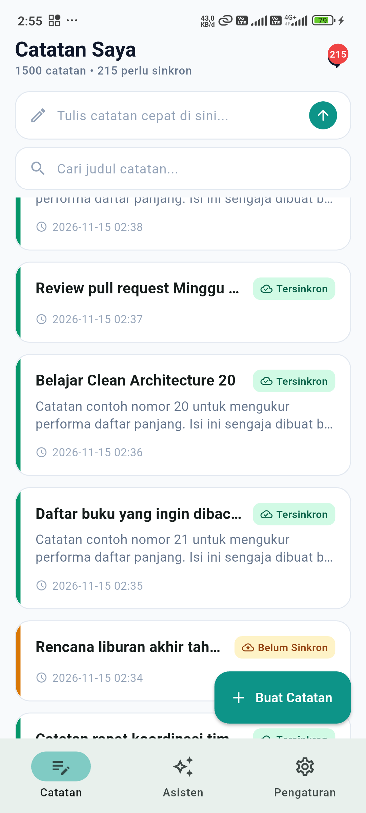
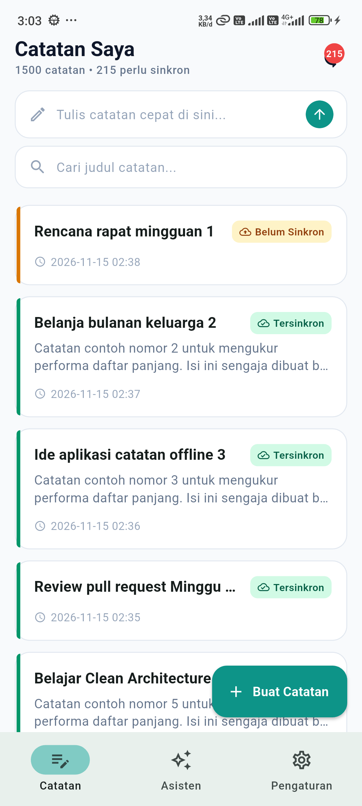
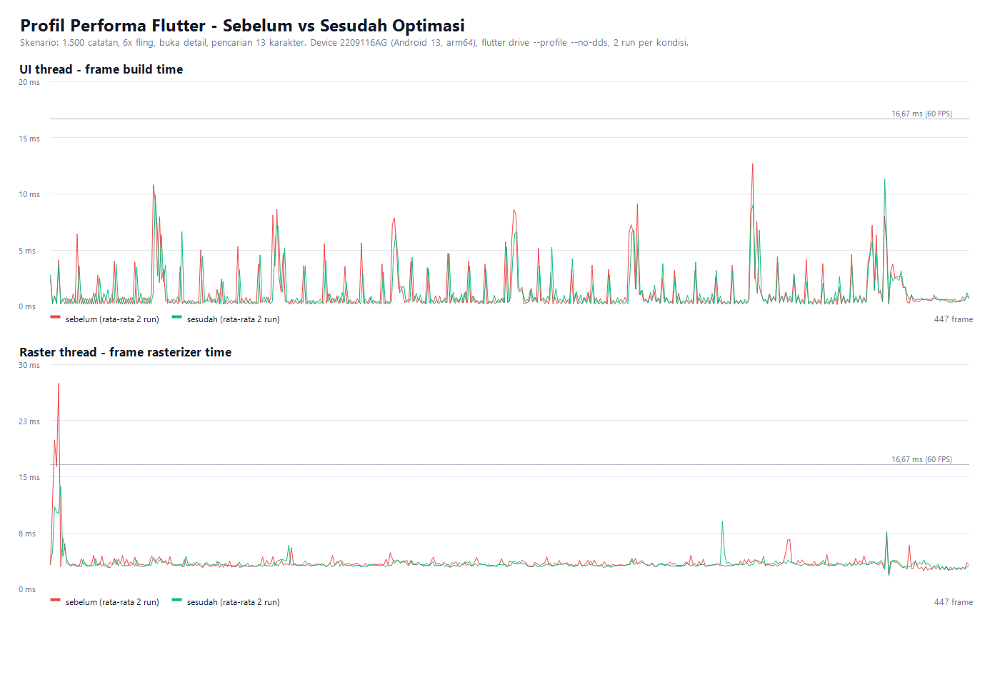
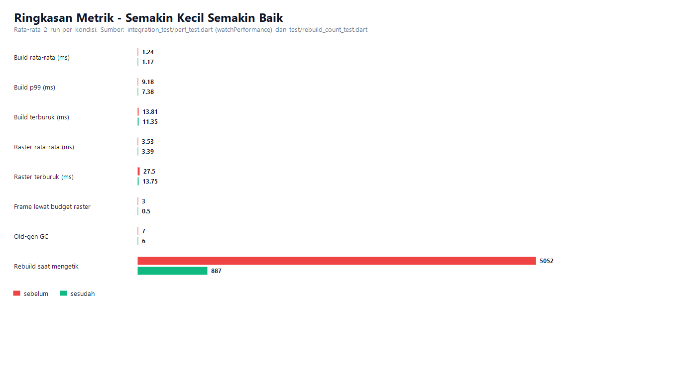

# Laporan Performa — Minggu 11

Laporan ini menjawab tiga hal: **apa yang diukur**, **apa yang diubah**, dan
**bagaimana dibuktikan bahwa perubahannya bekerja** — bukan sekadar "terasa
lebih cepat".

- **Aplikasi:** `week5_offline_notes` (hasil Minggu 5–10)
- **Perangkat:** `2209116AG` — Android 13 (API 33), arm64
- **Mode pengukuran:** `flutter drive --profile --no-dds`
- **Data uji:** 1.500 catatan di SQLite lokal
- **Run:** 2 run untuk kondisi **sebelum** dan 2 run untuk **sesudah**

## 1. Ringkasan hasil

| Metrik | Sebelum | Sesudah | Perubahan |
| :--- | ---: | ---: | ---: |
| Rebuild total saat mengetik 13 karakter | 5.052 | **887** | **−82,4%** |
| Rebuild `NotesPage` per ketikan | 13 | **0** | **−100%** |
| Rebuild `NoteTile` | 78 | **6** | −92,3% |
| Frame build p99 | 9,18 ms | **7,38 ms** | **−19,6%** |
| Frame build terburuk | 13,81 ms | **11,35 ms** | **−17,8%** |
| Frame raster terburuk | 27,50 ms | **13,75 ms** | **−50,0%** |
| Frame melewati budget raster (dari ±447) | 3 | **1 dan 0** | **−67%…−100%** |
| Frame raster rata-rata | 3,53 ms | 3,39 ms | −4,0% |
| Frame build rata-rata | 1,24 ms | 1,17 ms | −5,6% |
| Old-gen GC per skenario | 7 | 6 | −14,3% |
| RSS setelah 5x buka-tutup detail | +4,5 MB | +3,5 MB | tidak signifikan |

Angka "sebelum"/"sesudah" adalah rata-rata dua run. Setiap run mentah ada di
[`measurements/`](measurements/).

**Cara membaca tabel ini dengan jujur:**

- Rata-rata frame build/raster **tidak berubah banyak**. Itu wajar: di mode
  profile, `ListView.builder` sudah lazy, jadi rata-rata didominasi pekerjaan
  yang memang harus terjadi.
- Yang berubah besar adalah **ekor distribusi** (p99, frame terburuk) dan
  **jumlah frame yang melewati budget**. Itu yang menentukan apakah scroll
  terasa patah-patah atau tidak.
- Metrik rebuild bersifat deterministik (bukan sampling), sehingga menjadi
  bukti terkuat di laporan ini.

## 2. Metodologi

### 2.1 Skenario

`integration_test/perf_test.dart`:

1. Seed 1.500 catatan ke SQLite (langsung, via batch insert).
2. Jalankan aplikasi, tunggu stabil.
3. Di dalam `binding.watchPerformance(...)`:
   - fling daftar 6x,
   - fling balik, buka detail, kembali,
   - cari `belanja`, kosongkan,
   - ketik `rencana rapat` 13 karakter (50 ms per karakter).
4. Setelah blok performa: buka-tutup detail 5x sambil mencatat RSS.

### 2.2 Mengapa `--profile --no-dds`

- Mode `debug` punya overhead besar dan angka frame-nya tidak representatif.
- `--no-dds` wajib: tanpa itu `watchPerformance` gagal karena koneksi VM
  Service dari dalam aplikasi ditolak (DDS mem-proxy port).

### 2.3 Mengapa dua run

Pengukuran frame di perangkat punya variasi antar-run, terutama nilai
terburuk. Contohnya frame raster terburuk baseline: **33,8 ms** di run 1 dan
**21,2 ms** di run 2. Satu run bisa menyesatkan ke dua arah. Karena itu:

- semua tabel memakai rata-rata dua run,
- grafik memakai rata-rata dua run per frame (bukan memilih run terbaik),
- kesimpulan hanya diambil bila **arah perubahannya konsisten di kedua run**.

### 2.4 Reproduksi

```bash
cd 11-week-11-performance-optimization

flutter drive --profile --no-dds -d 5751c2fd0013 \
  --driver=test_driver/integration_test.dart \
  --target=integration_test/perf_test.dart

flutter test test/rebuild_count_test.dart
dart run tool/search_bench.dart
```

## 3. Baseline dan temuan

Detail lengkap ada di [`performance-findings.md`](performance-findings.md).
Ringkasnya, lima masalah yang terukur:

| # | Temuan | Bukti |
| :--- | :--- | :--- |
| 1 | Satu ketikan membangun ulang seluruh halaman | 388,6 elemen rebuild per ketikan |
| 2 | Statistik daftar dipindai ulang setiap build | `notes.where(dirty).length` di `build` |
| 3 | Penyaringan tanpa jeda | 13 karakter = 13 pass atas 1.500 judul |
| 4 | `IntrinsicHeight` + `ClipRRect` per item | layout 2x + `saveLayer` per item |
| 5 | Daftar mengelola seluruh 1.500 item | tanpa pagination, keepAlive per item |

## 4. Optimasi yang diterapkan

### 4.1 Isolasi rebuild: pecah halaman per tanggung jawab

**Masalah.** `NotesPage.build` mengamati `notesProvider`,
`filteredNotesProvider`, dan `searchQueryProvider` sekaligus. Setiap karakter
membangun ulang AppBar, kolom input cepat, kolom pencarian, dan daftar.

**Perubahan.** Halaman dipecah menjadi empat widget dengan ketergantungan
masing-masing:

| Widget | Mengamati | Tidak lagi ikut rebuild saat mengetik |
| :--- | :--- | :--- |
| `NotesAppBar` | `noteStatsProvider` | ya |
| `QuickAddBar` | — | ya |
| `NoteSearchField` | teks controller (hanya ikon clear) | ya |
| `NotesList` | `filteredNotesProvider`, `searchQueryProvider` | **tidak** (memang perlu) |

`NotesPage` sendiri tidak mengamati provider data apa pun, sehingga rebuild-nya
**0** saat mengetik.

```dart
// Sebelum: satu build untuk semuanya
final notesAsyncValue = ref.watch(notesProvider);
final filteredNotesAsyncValue = ref.watch(filteredNotesProvider);
final searchQuery = ref.watch(searchQueryProvider);

// Sesudah: hanya subtree yang terdampak
Expanded(child: NotesList(onClearSearch: _clearSearch)),
```

**Verifikasi.** `test/rebuild_count_test.dart`: rebuild `NotesPage` 13 → **0**,
total 5.052 → **887**.

**Trade-off.** Jumlah berkas bertambah (satu halaman menjadi empat widget) dan
`NotesList` harus menerima callback `onClearSearch`. Ini kompleksitas yang
wajar karena batas tanggung jawabnya jelas; bukan sekadar memindahkan kode.

### 4.2 Statistik turunan, bukan dihitung di `build`

**Masalah.** `notesList.where((n) => n.dirty).length` memindai 1.500 catatan
setiap rebuild — termasuk setiap ketikan.

**Perubahan.** Provider turunan yang dihitung sekali per perubahan data:

```dart
final noteStatsProvider = Provider.autoDispose<({int total, int dirty})>((ref) {
  final notes = ref.watch(notesProvider).value ?? const <Note>[];
  var dirty = 0;
  for (final note in notes) {
    if (note.dirty) dirty++;
  }
  return (total: notes.length, dirty: dirty);
});
```

Nilai balik berupa record. Record dibandingkan berdasarkan isi, sehingga bila
total dan dirty tidak berubah, tidak ada rebuild.

**Bonus.** Aplikasi punya 215 catatan `dirty`; angka badge di AppBar kini
berasal dari satu sumber dengan teks "perlu sinkron", tidak dihitung dua kali
dengan cara berbeda.

### 4.3 Debounce 250 ms pada pencarian

**Masalah.** Setiap karakter langsung memicu penyaringan penuh.

**Perubahan.** `NotesPage` menunda pembaruan `searchQueryProvider`:

```dart
void _onSearchChanged(String value) {
  _searchTimer?.cancel();
  if (value.isEmpty) {
    ref.read(searchQueryProvider.notifier).clear();
    return;
  }
  _searchTimer = Timer(_searchDebounce, () {
    if (!mounted) return;
    ref.read(searchQueryProvider.notifier).update(value);
  });
}
```

Timer dibatalkan di `dispose()`, dan hasil timer dicek dengan `mounted` sebelum
menyentuh provider.

**Verifikasi.** `dart run tool/search_bench.dart` (1.500 judul):

```text
1 pass             : 129.1 us
13 pass (mengetik) : 1687.4 us
dihemat debounce   : 1558.3 us (92.4%)
```

Jadi setiap "burst" mengetik menghemat sekitar 92% kerja penyaringan. Angka
ini dari mesin desktop (JIT), jadi yang relevan adalah rasionya, bukan
nilai absolutnya.

**Trade-off.** Hasil pencarian muncul 250 ms lebih lambat. Untuk pencarian
lokal berukuran 1.500 baris, jeda itu tidak terasa; untuk pencarian yang harus
memanggil server, debounce justru wajib.

### 4.4 Hapus `IntrinsicHeight` dan `ClipRRect` dari item

**Masalah.** `IntrinsicHeight` memaksa layout dua kali per item; `ClipRRect`
membuat satu `saveLayer` per item. Keduanya dibayar ulang setiap item masuk
viewport.

**Perubahan.** Garis aksen kiri digambar sebagai `Positioned` di dalam `Stack`,
sehingga tinggi mengikuti konten tanpa pengukuran intrinsik dan tanpa clip:

```dart
// Sebelum
ClipRRect(
  child: IntrinsicHeight(
    child: Row(crossAxisAlignment: CrossAxisAlignment.stretch, ...),
  ),
)

// Sesudah
Stack(
  children: [
    Positioned(left: 1, top: 1, bottom: 1, width: 4, child: DecoratedBox(...)),
    Padding(padding: const EdgeInsets.only(left: 4), child: InkWell(...)),
  ],
)
```

**Verifikasi.** Frame raster terburuk 27,50 → **13,75 ms** (−50%) dan frame yang
melewati budget raster 3 → **1 dan 0**. Frame build p99 juga turun 19,6%,
karena layout ikut dihitung di UI thread.

**Trade-off.** Splash `InkWell` tidak lagi terpotong rapi oleh sudut kartu.
Pada kartu dengan latar opak, efek splash memang sudah nyaris tak terlihat
sebelum perubahan ini, jadi secara visual tidak ada regresi yang berarti.
Kalau nanti kartu diberi latar transparan, `Material(clipBehavior: ...)`
perlu dikembalikan **hanya** untuk kartu tersebut.

### 4.5 Pagination 60 item + tanpa keep-alive

**Masalah.** Daftar menyerahkan 1.500 item ke `ListView` sekaligus dan setiap
item dibungkus `AutomaticKeepAlive`.

**Perubahan.** `NotesList` merender maksimal 60 item, menambah 60 item saat
posisi scroll tersisa < 400 px, dan memakai:

```dart
ListView.builder(
  controller: _scrollController,
  addAutomaticKeepAlives: false, // item tidak punya state
  itemCount: visibleNotes.length + (hasMore ? 1 : 0),
  ...
)
```

Saat kata kunci berubah, daftar kembali ke halaman pertama. Penanda "Memuat
catatan..." sengaja **tanpa animasi**, supaya `pumpAndSettle` di test tidak
menunggu animasi yang tidak pernah berhenti.

**Trade-off.** Ada satu status tambahan (`_limit`) dan satu `ScrollController`
yang harus di-`dispose()`. Untuk 1.500 item lokal, keuntungan pagination
memang lebih kecil dibanding poin 4.1–4.4; nilainya lebih terasa saat data
datang dari jaringan.

## 5. Bukti visual

<div align="center">
  
  <p><em>Gambar 5.1: Kondisi awal — 1.500 catatan, 215 belum sinkron.</em></p>
</div>

<div align="center">
  
  <p><em>Gambar 5.2: Setelah optimasi — tampilan tetap sama; yang berubah adalah biaya membangunnya.</em></p>
</div>

<div align="center">
  
  <p><em>Gambar 5.3: Frame build dan raster per frame (rata-rata 2 run). Garis putus-putus = budget 16,67 ms.</em></p>
</div>

<div align="center">
  
  <p><em>Gambar 5.4: Ringkasan metrik sebelum vs sesudah.</em></p>
</div>

## 6. Memory profiling

Modul meminta perbandingan heap snapshot sebelum/sesudah navigasi. Yang
dilakukan di sini adalah pengukuran **RSS proses** (`ProcessInfo.currentRss`)
sebelum dan sesudah 5x buka-tutup detail, karena heap snapshot DevTools
bersifat manual dan tidak bisa direproduksi otomatis oleh test.

| Run | Sebelum | Sesudah | Delta |
| :--- | ---: | ---: | ---: |
| Baseline 1 | 236 MB | 240 MB | +3 MB |
| Baseline 2 | 234 MB | 240 MB | +6 MB |
| Setelah 1 | 239 MB | 242 MB | +2 MB |
| Setelah 2 | 231 MB | 237 MB | +5 MB |

Angka mentahnya ada di [`measurements/memory.json`](measurements/memory.json).

Kesimpulan: **tidak ada indikasi kebocoran** di kedua kondisi. Delta antar-run
(3–6 MB) lebih besar daripada delta antar-kondisi, jadi klaim "optimasi
mengurangi memori" tidak bisa dibuat — dan memang tidak dibuat. `RSS` juga
tidak menurun setelah GC karena allocator belum mengembalikan halaman ke OS.

Yang tetap diperiksa manual: semua `TextEditingController` dan
`ScrollController` baru di-`dispose()`, dan `_onScroll` melepas listener
sebelum controller di-dispose.

## 7. Yang tidak dioptimasi (dan alasannya)

| Kategori modul | Keputusan | Alasan |
| :--- | :--- | :--- |
| Optimasi gambar | Dilewati | Tidak ada gambar jaringan/aset besar di aplikasi catatan |
| Cache gambar (`CachedNetworkImage`) | Tidak ditambahkan | Menambah dependensi untuk fitur yang tidak dipakai |
| Caching jaringan catatan | Tidak diubah | Catatan sepenuhnya lokal (SQLite) |
| Caching halaman Posts | Tidak diubah | Sudah cache-first sejak Minggu 5 |
| Heap snapshot otomatis | Diganti RSS | DevTools heap snapshot manual; RSS bisa direproduksi |

Menambahkan `CachedNetworkImage` pada aplikasi tanpa gambar akan terlihat
"sibuk" di laporan tetapi tidak mengubah satu frame pun. Itu contoh optimasi
prematur yang diminta modul untuk dihindari.

## 8. Quality gate

```text
$ flutter analyze
No issues found! (ran in 2.9s)

$ dart format --set-exit-if-changed lib test integration_test tool
Formatted 58 files (0 changed)

$ flutter test
00:06 +44: All tests passed!
```

Test baru untuk Minggu 11:

| Berkas | Isi |
| :--- | :--- |
| `test/rebuild_count_test.dart` | Menghitung rebuild lewat `debugOnRebuildDirtyWidget`; gagal bila `NotesPage` ikut rebuild atau total rebuild > 1.200 |
| `integration_test/perf_test.dart` | Skenario profiling + pengukuran RSS 5x navigasi |
| `test_driver/integration_test.dart` | Driver `flutter drive` |

`integration_test` adalah bagian dari SDK Flutter (`sdk: flutter`), jadi tidak
ada dependensi pihak ketiga baru.

## 9. Risiko dan batasan

| Risiko | Dampak | Mitigasi |
| :--- | :--- | :--- |
| Angka frame hanya dari satu perangkat | Tidak mewakili perangkat low-end | Dua run per kondisi; kesimpulan diambil dari arah yang konsisten, bukan satu run |
| Mode profile tetap bukan release | Angka absolut lebih tinggi dari release | Perbandingan before/after dilakukan pada mode yang sama |
| `debugOnRebuildDirtyWidget` hanya di debug | Tidak tersedia di release | Dipakai di `flutter test` (debug), bukan untuk klaim produksi |
| Pagination mengubah UX | Pengguna harus scroll untuk data berikutnya | Halaman 60 item + ambang 400 px, cukup untuk daftar lokal |
| Debounce menunda hasil | Terasa "tidak responsif" bila terlalu besar | 250 ms; kolom tetap menampilkan teks segera |

## 10. Refleksi

**Optimasi mana yang berdampak paling besar dan mengapa?**
Isolasi rebuild (4.1) plus debounce (4.3). Keduanya menghapus pekerjaan yang
memang tidak perlu: 5.052 → 887 rebuild dan 13 → 1 pass penyaringan. Ini
terukur deterministik, bukan bergantung nasib sampling frame. Di sisi raster,
penghapusan `IntrinsicHeight`/`ClipRRect` yang paling terasa: frame terburuk
turun setengah.

**Bagaimana memastikan ini bukan placebo?**
Tiga lapis: (1) hitungan rebuild deterministik, (2) dua run profiling dengan
arah perubahan yang konsisten, (3) benchmark terisolasi untuk penyaringan.
Saya juga sengaja **tidak** mengklaim perbaikan pada metrik yang tidak
konsisten — misalnya rata-rata frame build yang hanya bergerak 5% dan berada
di dalam noise.

**Trade-off yang dihadapi?**
Empat widget baru dan satu `ScrollController` tambahan; splash `InkWell` tidak
lagi ter-clip; hasil pencarian tertunda 250 ms. Semuanya kecil dibanding
pekerjaan yang dihemat, tetapi tetap harus disebut karena mengubah struktur
kode dan sedikit perilaku.

**Kapan optimasi prematur harus dihindari?**
Saat belum ada angka. Contoh nyata di Minggu 11: aplikasi ini **tidak punya**
gambar jaringan, jadi semua teknik optimasi gambar di modul tidak relevan.
Menambahkannya hanya akan menambah dependensi dan kode tanpa satu frame pun
membaik. Sebaliknya, `IntrinsicHeight` terlihat tidak berbahaya di kode, dan
baru terbukti mahal setelah frame raster terburuk diukur.
