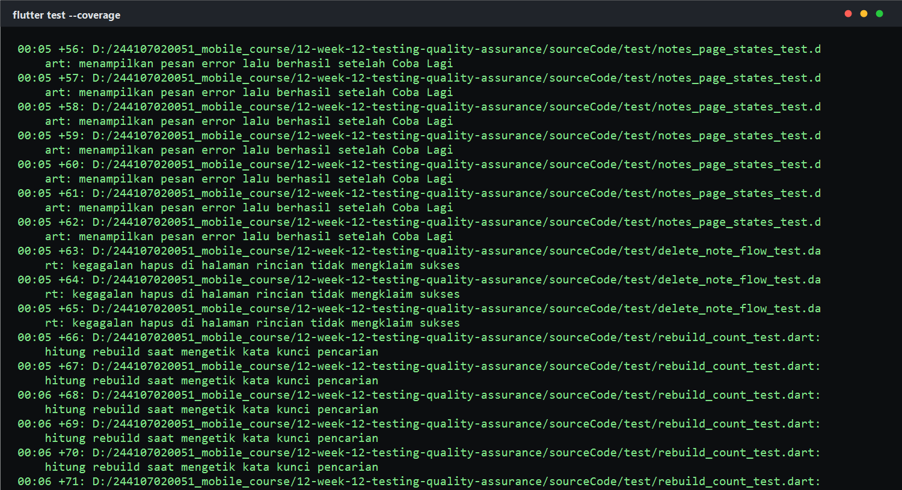
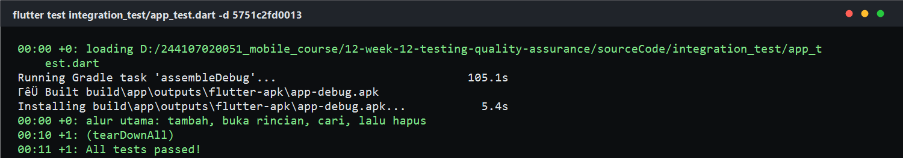
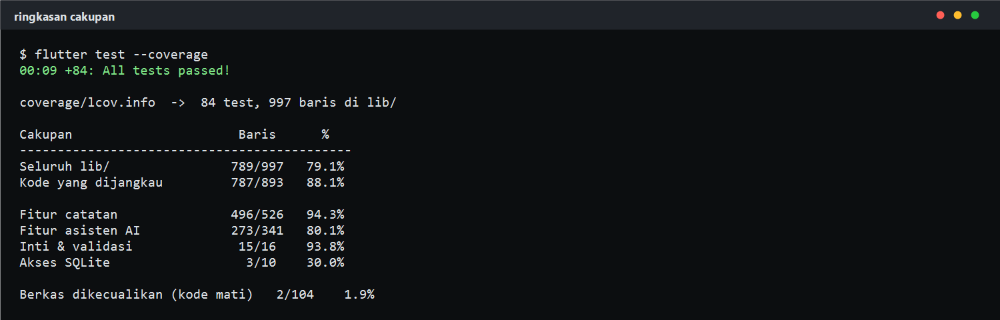
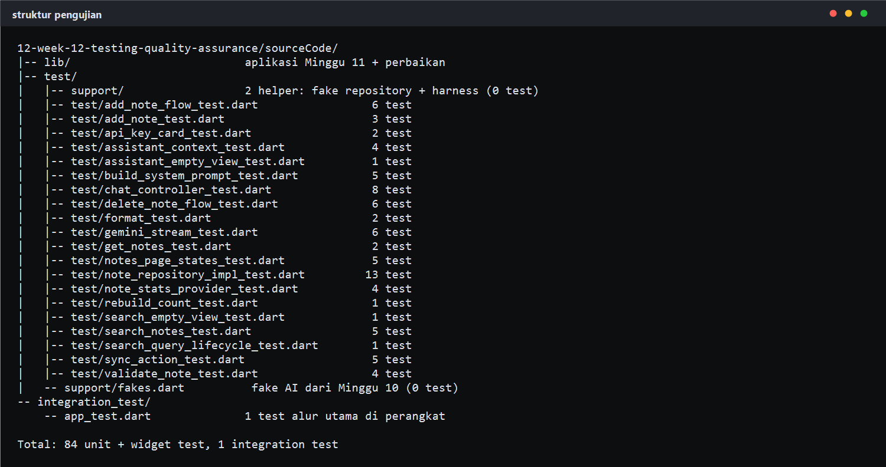

# Laporan Praktikum Minggu 12: Pengujian dan Jaminan Kualitas

**Nama Mahasiswa:** Ahmad Zainudin Fanani
**NIM:** 244107020051
**Mata Kuliah:** Pemrograman Mobile
**Basis Proyek:** `week5_offline_notes` — hasil Minggu 11 (`11-week-11-performance-optimization`)
**Tautan Repositori:** [244107020051_mobile_course](https://github.com/Ahmad-Zainudin-Fanani/244107020051_mobile_course)
**Laporan pengujian lengkap:** [`docs/test-report.md`](docs/test-report.md)
**Ringkasan cakupan (dibuat otomatis):** [`docs/coverage-summary.md`](docs/coverage-summary.md)
**Issue:** _dibuat sebelum PR — lihat §9_
**Pull Request:** _branch `feature/testing-quality-assurance` — lihat §9_

---

## 1. Ringkasan

Minggu 12 tidak menambah fitur. Saya menulis pengujian untuk aplikasi catatan
yang sudah selesai, memakai pengujian itu untuk **menemukan** cacat, lalu
memperbaiki cacat tersebut dan menjaga perbaikannya dengan test.

Hasil utamanya:

| Aspek | Sebelum | Sesudah |
| :--- | ---: | ---: |
| Test otomatis | 44 | **84** |
| Cakupan seluruh `lib/` | 57,4% | **79,1%** |
| Cakupan kode yang dijangkau aplikasi | — | **88,1%** |
| Cakupan fitur catatan | — | **94,3%** |
| Cacat ditemukan & diperbaiki | — | **4** |

Empat cacat itu bukan hipotetis: dua di antaranya membuat aplikasi
**mengklaim penghapusan/sinkronisasi berhasil padahal gagal**, dan satu lagi
membuat kegagalan hapus tidak terlihat sama sekali oleh pengguna.

| Target modul | Hasil |
| :--- | :---: |
| Minimal tiga skenario: sukses, kasus tepi, kegagalan | **Lolos** — 84 test, tabel di §3 |
| Pengujian unit untuk validasi/aturan bisnis, dikelompokkan `group` | **Lolos** — `note_repository_impl_test.dart` (7 sukses + 6 gagal) |
| Dependensi dipisah + fake untuk data sukses dan error | **Lolos** — `FakeNoteRepository` di `test/support/` |
| Pengujian widget: tampilan awal, input tidak valid, aksi berhasil | **Lolos** — 27 widget test |
| Satu pengujian integrasi alur utama | **Lolos** — `integration_test/app_test.dart` di `5751c2fd0013` |
| `flutter test` | **Lolos** — 84 test |
| `flutter analyze` | **Lolos** — `No issues found!` |
| `flutter test --coverage` sebagai bahan evaluasi | **Lolos** — 79,1% total / 88,1% kode yang dijangkau |
| Temuan belum terselesaikan dicatat di README | **Lolos** — §7 dan §10 |

---

## 2. Strategi pengujian

| Jenis | Yang diperiksa | Contoh | Jumlah |
| :--- | :--- | :--- | ---: |
| Unit | logika tanpa UI | repository di SQLite asli, use case, validasi, prompt | 57 |
| Widget | tampilan + interaksi | loading, error, kosong, form, hapus, sinkronisasi | 27 |
| Integrasi | alur utuh di perangkat | tambah → rincian → cari → hapus | 1 |

Prinsip yang saya pakai untuk memilih bagian yang diuji:

1. **Risiko data lebih dulu.** Tambah/hapus/sinkronisasi menyentuh data
   pengguna, jadi jalur gagalnya diuji, bukan hanya jalur suksesnya.
2. **Uji perilaku, bukan baris.** Tidak ada test yang hanya memanggil fungsi
   untuk menaikkan persentase. Setiap test punya `expect` yang akan gagal bila
   perilakunya rusak.
3. **Fake untuk kontrol, database asli untuk kebenaran.** Widget test memakai
   fake supaya cepat dan deterministik; repository diuji dengan SQLite
   in-memory supaya SQL-nya benar-benar dijalankan.
4. **Kode mati tidak diuji.** Enam berkas sisa fitur lama tidak dapat
   dijangkau dari `main.dart`; mengujinya hanya mempercantik angka. Alasannya
   dicatat di §7 dan di `docs/coverage-summary.md`.

---

## 3. Skenario yang diuji

| Perilaku | Sukses | Input tidak valid | Error |
| :--- | :--- | :--- | :--- |
| Tambah catatan | tersimpan, muncul di daftar, spasi dibuang | judul kosong ditolak, repository tidak dipanggil | SnackBar, form tidak menampilkan catatan palsu |
| Hapus dari daftar | hilang dari daftar | konfirmasi "Batal" tidak menghapus | SnackBar, catatan tetap ada |
| Hapus dari rincian | kembali + pesan sukses | — | tetap di halaman, pesan gagal, tanpa klaim sukses |
| Sinkronisasi | status "Semua tersinkron" | tidak ada catatan dirty → tidak menulis | gagal hitung dan gagal tulis dilaporkan |
| Daftar catatan | 2 catatan + badge status | — | pesan + "Coba Lagi" memulihkan |
| Pencarian | menyaring, hapus filter memulihkan | tanpa hasil → empty state | — |
| Repository SQLite | simpan/baca/urut/hapus/hitung | id tidak ada → `null` | database gagal → `Failure`, bukan exception |

Daftar berkas test dan jumlahnya ada di [`docs/test-report.md` §3](docs/test-report.md).

---

## 4. Perubahan kode

### 4.1 Kode produksi yang diubah agar dapat diuji

| Berkas | Perubahan | Alasan |
| :--- | :--- | :--- |
| `lib/data/local/db.dart` | `createNotesSchema(Database)` diekstrak dari `openNotesDb` | test memakai skema yang sama, tidak menyalin SQL |
| `quick_add_bar.dart`, `note_search_field.dart`, `notes_app_bar.dart`, `notes_page.dart` | `Key` pada 7 kontrol | pencarian widget tidak bergantung pada teks |
| `notes_list.dart` | periksa hasil `deleteNote` | cacat §6.1 |
| `note_detail_page.dart` | periksa hasil `deleteNote` | cacat §6.2 |
| `notes_app_bar.dart` | periksa `countDirty` dan `markAllSynced` | cacat §6.3 dan §6.4 |

Tidak ada logika bisnis yang dipindahkan hanya demi test. Repository dan use
case memang sudah dipisah sejak Minggu 7, jadi yang kurang hanya titik masuk
untuk mengganti dependensi — dan itu sudah ada (`openDb` di konstruktor).

### 4.2 Kode test baru

```text
test/
├── support/
│   ├── note_fakes.dart            # FakeNoteRepository + sampleNotes()
│   └── notes_test_harness.dart    # pump, scope, offline, debounce, retry mati
├── note_repository_impl_test.dart # 13 test, SQLite in-memory
├── note_stats_provider_test.dart  # 4 test
├── notes_page_states_test.dart    # 5 test
├── add_note_flow_test.dart        # 6 test
├── delete_note_flow_test.dart     # 6 test
└── sync_action_test.dart          # 5 test
integration_test/
└── app_test.dart                  # 1 alur utama di perangkat
```

Test lama yang punya fake sendiri (`get_notes_test.dart`, `add_note_test.dart`,
`rebuild_count_test.dart`) diubah memakai `FakeNoteRepository` bersama supaya
tidak ada tiga definisi fake yang bisa berbeda perilaku.

### 4.3 Dependensi

`sqflite_common_ffi` ditambahkan sebagai `dev_dependency`. Paket ini
menjalankan SQLite asli di mesin test, sehingga repository diuji terhadap
database sungguhan tanpa emulator.

---

## 5. Cara menjalankan

Dari `12-week-12-testing-quality-assurance/sourceCode`:

```bash
flutter pub get

# Unit + widget test, sekaligus menghasilkan coverage/lcov.info
flutter test --coverage

# Ringkasan cakupan (dokumen dibuat ulang dari lcov, bukan diketik manual)
python docs/tools/coverage_summary.py \
  --lcov coverage/lcov.info \
  --out docs/coverage-summary.md

# Analisis statis dan format
flutter analyze
dart format --output=none --set-exit-if-changed lib test integration_test tool

# Pengujian integrasi di perangkat
flutter test integration_test/app_test.dart -d 5751c2fd0013
```

Menjalankan satu berkas test:

```bash
flutter test test/sync_action_test.dart
```

---

## 6. Hasil pengujian

### 6.1 Quality gate

```text
$ flutter analyze
No issues found! (ran in 2.8s)

$ dart format --output=none --set-exit-if-changed lib test integration_test tool
Formatted 67 files (0 changed) in 0.18 seconds.

$ flutter test --coverage
00:08 +84: All tests passed!
```

| Pemeriksaan | Hasil |
| :--- | :--- |
| `flutter analyze` | **0 issue** |
| `dart format --set-exit-if-changed` | **67 berkas, 0 berubah** |
| `flutter test` | **84 test lolos** |



### 6.2 Pengujian integrasi di perangkat

| Item | Nilai |
| :--- | :--- |
| Perangkat | `2209116AG` — Android 13 (API 33) |
| Serial | `5751c2fd0013` |
| Perintah | `flutter test integration_test/app_test.dart -d 5751c2fd0013` |
| Alur | tambah → buka rincian → kembali → cari → hapus |
| Hasil | **1 test lolos** |

Test ini memakai database sungguhan di perangkat, sehingga membuktikan widget,
provider, use case, dan SQLite bekerja bersama — hal yang tidak bisa
dibuktikan widget test dengan repository palsu.



Run pertama di perangkat **gagal** dan itu berguna: `find.text(title)`
menemukan dua widget karena kolom pencarian juga memuat judul yang dicari.
Test diperbaiki memakai `find.widgetWithText(NoteTile, title)`.

### 6.3 Cakupan kode

| Ukuran | Minggu 11 | Minggu 12 |
| :--- | ---: | ---: |
| Test | 44 | **84** |
| Baris tercakup / total | 520/906 | **789/997** |
| Seluruh `lib/` | 57,4% | **79,1%** |
| Kode yang dijangkau aplikasi | — | **88,1%** (787/893) |
| `lib/features/notes/` | 88–96% per berkas | **94,3%** (496/526) |
| `lib/features/assistant/` | — | **80,1%** (273/341) |

Angka ini dihasilkan oleh `docs/tools/coverage_summary.py` dari
`coverage/lcov.info`; rincian per berkas ada di
[`docs/coverage-summary.md`](docs/coverage-summary.md).



---

## 7. Cacat yang ditemukan dan diperbaiki

| # | Cacat | Perbaikan | Test penjaga |
| ---: | :--- | :--- | :--- |
| 1 | Hapus dari daftar gagal tanpa pesan apa pun | periksa `deleteNote`, tampilkan SnackBar | `delete_note_flow_test.dart` |
| 2 | Halaman rincian tetap mengklaim "berhasil dihapus" saat gagal | tetap di halaman + pesan error | `delete_note_flow_test.dart` |
| 3 | Gagal `countDirty` ditampilkan sebagai "Semua catatan sudah tersinkron" | tampilkan failure, hentikan proses | `sync_action_test.dart` |
| 4 | Gagal `markAllSynced` tetap menampilkan "Berhasil!" | periksa hasil, tampilkan error | `sync_action_test.dart` |

Detail sebelum/sesudah ada di [`docs/test-report.md` §6](docs/test-report.md).
Keempatnya adalah contoh persis yang dimaksud modul: test yang ditulis untuk
memeriksa perilaku, bukan test yang sekadar lulus.

---

## 8. Temuan yang belum terselesaikan

| Temuan | Dampak | Rencana |
| :--- | :--- | :--- |
| `SyncService`, `syncServiceProvider`, `NoteRepository` lama, model `Note`/`Post` lokal, `PostsPage` tidak dipakai | kode mati, membingungkan, menurunkan cakupan | hapus pada pembersihan terpisah |
| Fitur Posts tidak dirutekan | tidak bisa diuji end-to-end | putuskan: hidupkan atau hapus |
| `openNotesDb()` butuh platform channel | 7 baris `db.dart` tidak tercakup | skema sudah diuji; sisanya hanya path database |
| Panggilan Gemini sungguhan tidak diuji | kesalahan format respons nyata tidak tertangkap | rekam respons untuk test kontrak |
| Cakupan integration test tidak digabung ke `lcov` | alur perangkat tidak menambah angka | gabungkan manual bila perlu |
| Retry Riverpod 3 aktif di produksi, mati di test | perilaku produksi dan test berbeda | pertimbangkan `retry` eksplisit di `ProviderScope` |

Keputusan yang saya ambil sadar: **enam berkas kode mati (104 baris) tidak
diuji** dan dikecualikan dari angka 88,1%. Menguji kode yang tidak bisa
dijalankan pengguna akan membuat laporan terlihat lebih baik tanpa menambah
satu pun perilaku yang terlindungi.

---

## 9. Alur Git

Branch: `feature/testing-quality-assurance`, bercabang dari
`feature/23-performance-optimization` (pekerjaan Minggu 11).

Commit dipisah agar diff mudah direview:

```text
chore: salin baseline project Minggu 11 ke folder Minggu 12
refactor(notes): ekstrak skema database dan beri Key pada kontrol utama
fix(notes): laporkan kegagalan hapus dan sinkronisasi dengan benar
test: tambah unit, widget, dan integration test alur utama
docs: laporan pengujian, cakupan, dan screenshot Minggu 12
docs: tautkan issue dan PR Minggu 11 di README
ci: verifikasi Minggu 12 di pipeline
ci: pasang libsqlite3 untuk test FFI Minggu 12
```

Langkah yang masih perlu dilakukan di GitHub (tidak bisa dari CLI karena `gh`
tidak terpasang di mesin ini):

1. Buat issue `test: pengujian dan jaminan kualitas aplikasi catatan Minggu 12`.
2. Buat PR dari `feature/testing-quality-assurance` ke `develop`, isi
   `Closes #<nomor issue>`.
3. Setelah nomor issue dan PR ada, tautkan di header README ini.

---

## 10. Struktur folder

```text
12-week-12-testing-quality-assurance/
├── README.md
├── docs/
│   ├── coverage-summary.md        # dibuat oleh tools/coverage_summary.py
│   ├── test-report.md             # laporan lengkap
│   └── tools/
│       └── coverage_summary.py    # parser lcov, tanpa dependensi
├── Screenshots/
│   ├── 01-hasil-flutter-test.png
│   ├── 02-cakupan-kode.png
│   ├── 03-integration-test-perangkat.png
│   └── 04-struktur-test.png
└── sourceCode/
    ├── lib/                       # aplikasi Minggu 11 + perbaikan §7
    ├── test/
    │   ├── support/               # fake + harness
    │   └── *_test.dart            # 20 berkas, 84 test
    └── integration_test/
        └── app_test.dart          # alur utama di perangkat
```



Gambar 01–04 adalah **keluaran perintah yang sebenarnya**, dirender menjadi PNG
oleh [`docs/tools/render_log.ps1`](docs/tools/render_log.ps1) supaya teksnya
tidak terpotong di laporan. Log aslinya dihasilkan ulang dengan perintah di §5.

---

## 11. Refleksi

### 11.1 Jawaban pertanyaan refleksi modul

**Bug apa yang paling mungkin terlewat tanpa pengujian yang Anda tulis?**
Kegagalan hapus dan kegagalan sinkronisasi. Ketiganya adalah jalur yang hanya
muncul saat database gagal, dan kegagalannya tidak terlihat: aplikasi tetap
terlihat normal, bahkan menampilkan pesan sukses. Tanpa test yang memaksa
`deleteNote`/`markAllSynced` mengembalikan `failure`, saya tidak akan pernah
melihatnya — di perangkat sehat, jalur itu tidak pernah dijalankan.

**Bagian mana yang perlu fake, dan bagaimana fake itu membuat pengujian lebih
konsisten?**
Widget dan provider perlu fake karena mereka tidak seharusnya peduli dari mana
data berasal. `FakeNoteRepository` membuat tiga hal konsisten: hasil bisa
ditentukan per test (sukses/gagal), jumlah panggilan bisa diperiksa (validasi
gagal berarti repository tidak boleh dipanggil), dan kegagalan bisa diubah di
tengah test untuk menguji "Coba Lagi". Tanpa fake, test akan bergantung pada
database perangkat dan urutan eksekusi.

**Apa perbedaan nilai yang diberikan pengujian widget dan pengujian integrasi
pada fitur Anda?**
Widget test membuktikan **reaksi UI** terhadap keadaan tertentu: pesan
validasi muncul, SnackBar kegagalan tampil, tombol "Coba Lagi" memulihkan
daftar. Ia cepat dan tidak butuh perangkat, tetapi memakai repository palsu.
Integration test membuktikan **rantai utuh** dengan database sungguhan: catatan
yang disimpan benar-benar muncul, bisa dicari, dan benar-benar terhapus. Nilai
widget test ada pada cakupan keadaan; nilai integration test ada pada
keyakinan bahwa bagian-bagian itu benar-benar terhubung.

### 11.2 Catatan tambahan

**Test pertama di perangkat gagal, dan itu bagian dari hasil.** Kegagalannya
bukan pada aplikasi, melainkan pada test: `find.text` juga mencocokkan isi
kolom pencarian. Kalau saya memaksa test itu lulus dengan `findsNWidgets(2)`,
test akan rapuh dan tidak menjelaskan apa pun. Perbaikannya adalah mencari
widget yang benar (`NoteTile`), bukan melonggarkan harapan.

**Retry Riverpod 3 hampir membuat test tidak deterministik.** Satu kegagalan
provider bisa berubah menjadi 11 panggilan `fetchNotes` karena retry otomatis.
Test yang mengandalkan jumlah panggilan akan lulus atau gagal tergantung waktu.
Solusinya mematikan retry di harness test — dan konsekuensinya dicatat sebagai
temuan, karena produksi tetap memakai retry.

**Cakupan bukan target.** Angka naik dari 57,4% ke 79,1% bukan karena mengejar
persentase, tetapi karena repository, provider, dan halaman akhirnya diuji
lewat perilakunya. Sebaliknya, saya sengaja **tidak** menguji 104 baris kode
mati meskipun itu akan menaikkan angka menjadi 88,1%.

**Yang paling murah justru paling berguna.** `createNotesSchema` hanya
memindahkan SQL ke fungsi terpisah, tetapi efeknya besar: test repository
sekarang gagal bila skema berubah tanpa migrasi. Perubahan kecil di kode
produksi bisa memberi perlindungan yang tidak bisa diberikan test tambahan.
